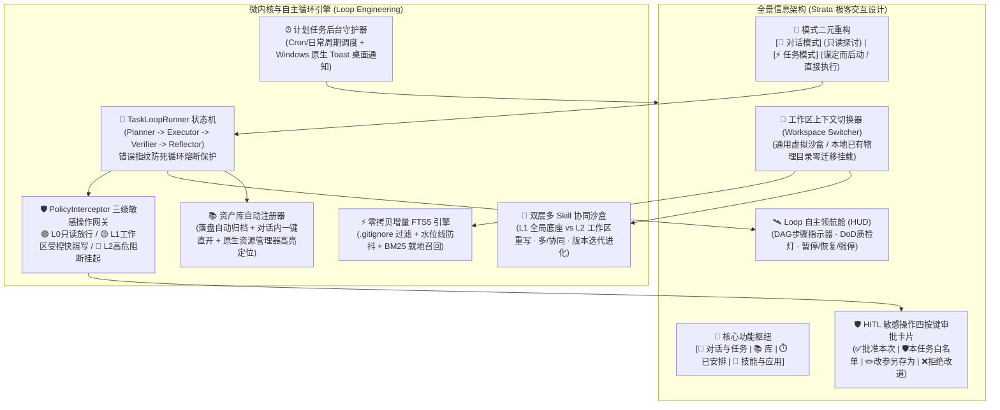
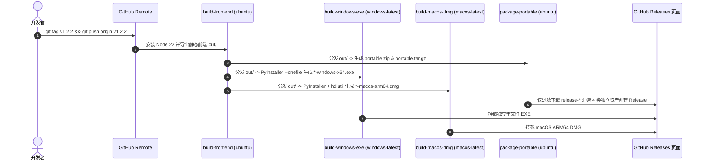

# AgentHub Local (本地多源算力中心与自主智能体工作台)

<p align="center">
  
  
  
  
  
  
  
  
</p>

> **数据与算力彻底解耦，告别单一模型绑定**：
> AgentHub Local 是专为极客与研发团队打造的**本地优先（Local-First）全场景智能体底座**。
> 所有会话历史、上下文快照、工作草稿、专属技能规程与长期记忆 100% 存留于本地原生 SQLite 数据库（WAL 并发模式 + FTS5 trigram 倒排全文检索）。无论接入本地私有大模型（Ollama、vLLM、Llama.cpp、Nvidia 实例），还是外部商业与开源 API（DeepSeek、Claude、OpenAI、SiliconFlow、Google AI），均充当无状态算力执行节点，零数据外泄，实现真正的个人私有化 AI 智能枢纽。

---

## 🧭 版本演进总览

### ✨ v1.2.0（最新 v1.2.4）— 本地上下文压缩、KV Cache 守护、双模性能水表与多源算力稳定化
- **Token 消耗与执行效率深度精调（v1.2.4）**：
  - **工具变体协议与空壳清洗**：100% 兼容属性式、紧凑前缀式与子标签嵌套式非标协议，清洗空白 `<tool_call>` 块，消除无效 40k 全文纠偏重发；支持任务标记完成时安全收尾。
  - **网络加速与模型级熔断锁**：降级备选链剔除 404 死模型，新增模型级 180s 熔断冷却锁（429 或连续 503 直跳 2.5-flash，TTFT 降至 1.5s 内）；Kimi/Moonshot 通道参数自适应；地区网络受限 300s 隔离。
  - **闲置记忆提炼去重锁**：180s 闲置提炼增加轮次水位锁与异常推进兜底，无新对话轮次零 Token 消耗、零空转，消除重复拉起 `agy.exe`。
  - **云端 36k 软上限坍缩与两级漏斗脱水**：激活云端大窗口 36,000 Tokens 经济软上限与 8 轮热区坍缩；Scrubber 阈值下探至 600 字符，$\le 3500$ 字符或无报错 100% 走纯 Python 规则提取（0 Token 开销、<1ms 延迟），超长报错采样限长 1500 字符以内，彻底扭转清洗倒挂；实现同路径多次写入历史自动折叠。
  - **ReAct 步数收敛与技能降载**：Zone 1 注入单步多工具并发、原地修改文件严禁副本与 Python 一次性诊断铁律；任务完成自动提炼关闭大模型调用，仅记轻量提议。
- **对话澄清自动升舱与真实落盘闭环（v1.2.3）**：在对话模式（chat）下启用需求澄清后，当用户在交互卡片中点击批准计划或立即执行时，前后端自适应联动升舱为 Agent 任务执行态，解开只读红线与工具安全限制，真实调用 `write_local_file` 与终端工具完成物理落盘并拉起 LOOP 自主领航舱。
- **过程思考与执行步骤流水线体验升级（v1.2.3）**：重构工具卡片与执行步骤可视化，单步工具彻底取消嵌套折叠直显关键文件路径与命令输出；深度思考卡片采用高质感弱化排版与流式微光状态，去除同轮次重复的模型头标识，呈现连贯丝滑的执行流水线。
- **多源算力稳定化与抗卡死治理（v1.2.2）**：严格隔离后台轻量旁路与 CLI/算力池异常告警，新增 KIMI 等模型 `temperature=1` 参数自适应与 400 非限流隔离；补全前端 SSE「停止生成」按钮、首包/空闲看门狗、宿主机探针主循环异步解耦与启动孤儿 Loop 自愈；同步落地算力池今日总消耗汇总、多源通道精准计数、DSML 工具标签防泄漏及思考过程样式弱化。
- **三区上下文压缩与 KV Cache 前缀守护**：划分 Zone 1（绝对不动前缀）+ Zone 2（只增不改热区 + 分块坍缩）+ Zone 3（跨轮零残留尾注），结合 SQLite FTS5 冷历史双路召回与工具长输出旁路脱水（`>1,000` 字符转 `Ref` + `read_tool_ref` 按行切片回查），最大化本地与云端 KV Cache 命中率。
- **`llama-server` 深度适配与全链路 Token 水表**：原生接入 `llama.cpp`（`/health`、`/props` 单槽位显存探测、`/tokenize` 与 `timings`），在每条回复底部渲染单行实时水表（上下文水位、KV Cache 命中率、脱水节省、TTFT/TPS），支持 `/stats` 查看全会话分角色消耗看板；未配置 Google 账号时自动隐藏未绑定 Gemini 模型，仅显示用户自有算力通道模型。
- **已有 Skill 迭代升级 & 多 Skill 协同编排**：基于已有 Skill 再次执行优化提炼时，支持直接迭代升级原 `SKILL.md` SOP 与语义化版本号；支持单条消息内通过 `/` 串联多个不同 Skill 协同完成任务。
- **长文本半屏编辑 & 执行步骤单行折叠**：长输入支持一键扩展至半屏高度查看与编辑；工具执行步骤区默认单行折叠摘要条，全端接入全新透明品牌图标并在设置「关于」页展示版本与开源地址。

### 🚀 v1.1.0 — 项目工作区中枢、Loop 自主循环、四层记忆治理与跨平台发布体系
- **通用工作区与零拷贝增量 FTS5**：支持托管虚拟沙盒与本地物理目录零迁移绑定、`.gitignore` 自动过滤与工作区独立 FTS5 trigram 倒排索引；实现基于 4KB Frontmatter 摘要与前端 SWR 的极速 Skill 列表秒开与 `L1/L2` 同名覆盖。
- **Loop 自主循环与 Plan-First 前置对齐**：落地 `Planner -> Executor -> Verifier -> Reflector` 自驱状态机、错误指纹防死循环熔断、物理只读硬门控、分步确认引导向导（含 `Tab` 跳选占位模板与防重复弹卡守卫）及 `L0 / L1 / L2` 三级敏感操作 HITL 四键审批网关。
- **四层记忆分层治理与经验自演化**：100% 基于本地 SQLite 构建滑动窗口增量摘要、支持工作区覆盖与一键回滚的双时间轴精确结构化事实（`FactManager`）、只增不改事件账本与凭据自动脱敏网关，以及任务后基于 Unified Diff 人工确认的 Skill 经验沉淀闭环。
- **全链路安全交付与多平台自动化打包**：支持工作区物理隔离上传（Office/PDF/源码/图片拖拽与粘贴）及反模型幻觉只读防线；打通生成文件对话内一键直开与资产库双向同步；建立 `version.json` 全局单一版本配置中心与 GitHub Actions 跨平台自动构建流水线（轻量便携包 / Windows x64 单文件 EXE / macOS ARM64 DMG）。

### 🌱 v1.0.0 — 本地多源算力解耦与自主智能体底座奠基
- **算力与数据完全解耦**：确立基于原生 SQLite WAL + FTS5 的纯本地持久化架构，支持本地私有推理引擎（Ollama / vLLM / Llama.cpp）与主流商业/开源 API 算力统一池化管理与故障冷却切换。
- **桌面级私有工作台基座**：完成 FastAPI 后端、Next.js 静态前端与原生桌面窗口集成，提供多会话历史持久化、流式工具调用、本地终端安全执行、基础 Skill 技能体系、MCP 扩展接入及中/繁/英/日四语种国际化底座。

---

## 🏗️ 系统架构视图 (Architecture Overview)



---

## 🌟 核心特性矩阵

### 1. 📂 通用工作区机制 (Workspace Hub & 物理目录绑定)
* **零业务硬编码**：全面支持用户自定义任意名称、任意业务属性的工作组（如 Web 全栈、自动化运维、法律/财务核算、个人知识库等）。
* **双模态工作区**：
  * **托管虚拟工作区**：用于临时问答与实验，数据安全存放于沙盒内；
  * **本地物理目录工作区**：直接挂载电脑上已有的代码或资料目录，**零迁移成本接入**。
* **物理 CWD 强锁定与防越界**：Agent 执行命令与写入文件严格锁定在工作区根路径下，禁止跨目录越界写；提供严格路径越界安全防御。
* **专属背景契约 (`WORKSPACE.md`)**：每个工作区可维护专属的技术栈规范或业务术语，AI 问答天然贴合项目语境。

---

### 2. 🔄 Loop 自主循环工程与防死循环熔断 (Loop Engineering)
* **`Planner -> Executor -> Verifier -> Reflector` 自驱状态机**：
  * **Planner**：自动拆解复杂目标为 DAG 子任务，实时同步写入 `<workspace>/.agenthub/scratchpad.md`；
  * **Executor**：在工作区物理路径下具身执行工具或命令；
  * **Verifier**：独立客观验收 (DoD 判定与返回码校验)；
  * **Reflector**：遭遇未通过或报错时自愈反思并调整策略。
* **错误指纹死循环熔断**：提取 `hash(error_type + error_message)` 错误指纹，**连续 3 次遭遇相同错误自动触发熔断保护**，杜绝死循环空转与 Token 浪费。
* **🧭 顶部 Loop 自主领航舱 (HUD)**：置顶展示子任务 DAG 步进、DoD 质检状态灯、当前迭代轮次，支持随时一键 `[暂停]`、`[继续]`、`[强停]`。

---

### 3. 🛡️ 三级敏感操作拦截网关与 HITL 人工审批 (PolicyInterceptor)
* 🟢 **L0（只读安全）**：文件读取、目录扫描、代码分析、无副作用查询 $\rightarrow$ 静默自动放行；
* 🟡 **L1（工作区受控写）**：在工作区物理路径内新建或修改文件 $\rightarrow$ 执行前自动在 `<workspace>/.agenthub/snapshots/` 创建轻量时间戳备份快照后放行；
* 🔴 **L2（高危拦截）**：跨目录越界写入、物理删除文件、不可逆破坏性 Shell 指令 $\rightarrow$ 挂起当前循环并呼出审批卡片：
  * **✅ 批准本次 (Approve Once)**：仅放行本次调用；
  * **🛡️ 本任务白名单 (Approve All)**：在当前任务生命周期内对该工具免密放行；
  * **✏️ 改参另存为 (Modify Args)**：人工在线修改参数并放行；
  * **❌ 拒绝并改道 (Reject & Reroute)**：驳回操作并附带引导建议，由 Reflector 重新规划。

---

### 4. ⚡ 本地物理目录零拷贝增量 FTS5 引擎 (Incremental FTS5)
* **智能规则过滤**：扫描前强制解析用户目录的 `.gitignore` 与 `.agenthubignore`，自动剔除 `node_modules`、`.git`、`dist`、超大日志及二进制文件；
* **增量水位线与防抖**：基于文件 `mtime + size + sha256` 维护水位线，仅对改动文件建立 trigram BM25 全文分词索引；
* **存储完全隔离**：索引统一存放于 `<workspace>/.agenthub/index.db`，绝不污染用户工程源码。

---

### 5. 🧩 双层多 Skill 协同沙盒与版本增量演进
* **L1 底座全局 Skill (`skills/`)**：随程序分发的通用环境体检、代码规范与文档助手；
* **L2 工作区私有 Skill (`<workspace>/skills/` 与 `<workspace>/.agenthub/skills/`)**：仅当前工作区可见，可随项目 Git 仓库协同提交；
* **同名覆盖与多 `/` 联合协同**：L2 同名 Skill 自动覆盖 L1 并在 UI 标出 `[工作区重写]`；单条指令支持多次 `/` 挂载协同多个 Skill 联合完成任务，支持基于已有 Skill 自动递增语义化版本号持续演进；
* **`/` 极速响应与 SOP 按需抽屉**：采用 4KB Frontmatter 轻量摘要 + 列表级快照缓存与前端 SWR 0ms 秒开缓存，海量技能下输入 `/` 或点击技能按钮瞬间弹出，点击 `[📖 SOP]` 再按需懒加载完整执行规程。

---

### 6. 📚 资产库统一归档与会话双向溯源 (LibraryView)
* **自动登记**：对话中使用 `[📥 一键落盘到工作区]` 或由 Loop 任务生成的文件、报表与可视化图表，自动向资产库登记元数据；
* **原生定位**：点击卡片一键唤起 Windows 原生资源管理器（`explorer /select`）高亮定位目标物理文件；
* **双向溯源**：资产可反查生成它的来源会话与 Prompt 历史。

---

### 7. ⏰ 无人值守计划任务中枢 (ScheduledView)
* **定时静默调度**：支持以 Cron 表达式或日常周期（daily、hourly、每周一等）定义计划任务；
* **桌面原生通知**：任务在后台执行完成后，自动调用 Windows 原生 Toast 桌面通知，实时提醒执行概况；
* **在线测试**：支持在控制台点击 `[立即测试]` 并在后台静默跑通全流程。

---

### 8. 🌍 全景四语种国际化 (i18n)
* 全量交互组件、工作区切换器、Loop 领航舱、审批卡片、SOP 抽屉及计划任务均已在 `i18nDictionary.ts` 中维护映射：
  * **简体中文 (zh-CN)**
  * **繁体中文 (zh-TW)**
  * **英语 (en)**
  * **日语 (ja)**

---

## 📦 多客户端离线包下载与运行

在 GitHub Releases 页面，我们为不同操作系统与使用场景提供了预编译离线包：

| 客户端版本 | 适用系统 | 包名称 | 运行方式 |
| :--- | :--- | :--- | :--- |
| **Windows 独立单文件桌面版** | Windows 10/11 x64 | `AgentHub-Local-v1.2.2-windows-x64.exe` | 免安装免解压，单文件双击直接运行（同级目录存数据，无权限时存 `%LOCALAPPDATA%\AgentHubLocal`） |
| **macOS 独立桌面安装版** | macOS Apple Silicon (ARM64) | `AgentHub-Local-v1.2.2-macos-arm64.dmg` | 打开镜像将 `AgentHub.app` 拖入 `Applications`；首次运行如遇未签名提示，右键「打开」或在终端执行 `xattr -cr /Applications/AgentHub.app` |
| **轻量便携包（Windows / 通用）** | Windows / 跨平台 | `AgentHub-Local-v1.2.2-portable.zip` | 不含 Python 二进制运行库（约 `~2.2 MB`），解压装好 `requirements.txt` 后运行 `启动AgentHub桌面版.bat` |
| **轻量便携包（macOS / Linux）** | macOS / Linux | `AgentHub-Local-v1.2.2-portable.tar.gz` | 不含 Python 二进制运行库（约 `~2.2 MB`），解压装好依赖后运行 `./启动AgentHub桌面版.sh` |
| **Docker 容器镜像** | 跨平台容器环境 | `docker-compose.yml` | `docker compose up -d` |

---

## 🛠️ GitHub Releases 自动打包机制 (CI/CD)

本项目配置了跨平台并行 GitHub Actions 自动化打包流水线（`.github/workflows/release.yml`）：



### 如何发布新版本：
只需在 `version.json` 更新版本号并运行 `python sync_version.py`（或直接运行 `python sync_version.py <version>`），随后在本地执行以下命令：
```bash
git tag -a v1.2.2 -m "Release v1.2.2"
git push origin master
git push origin v1.2.2
```
推送后，GitHub 会在云端全自动执行编译、矩阵打包并挂载 4 类干净的发行资产，几分钟内即可在 Releases 页面看到生成的下载文件！

---

## 💻 源码本地启动与开发

如果您希望从源码启动开发或调试：

### 1. 环境准备
- Python $\ge$ 3.10
- Node.js $\ge$ 18

### 2. 安装依赖
```bash
# 后端依赖安装
pip install -r requirements.txt

# 前端依赖安装
cd frontend
npm install
cd ..
```

### 3. 一键启动
```bash
# Windows 用户直接双击运行：
启动AgentHub桌面版.bat

# 或命令行方式启动原生桌面窗体：
python desktop_app.py
```

---

## 📄 开源许可证

本项目基于 [MIT License](LICENSE) 开源发布。
欢迎提交 Issue 与 Pull Request 共同完善 AgentHub Local 极客生态！
