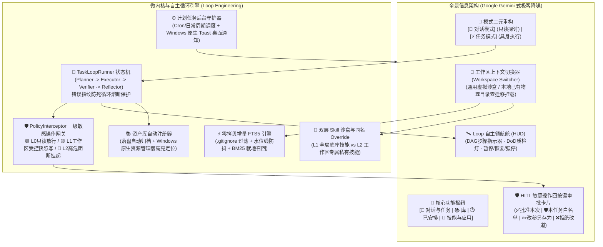
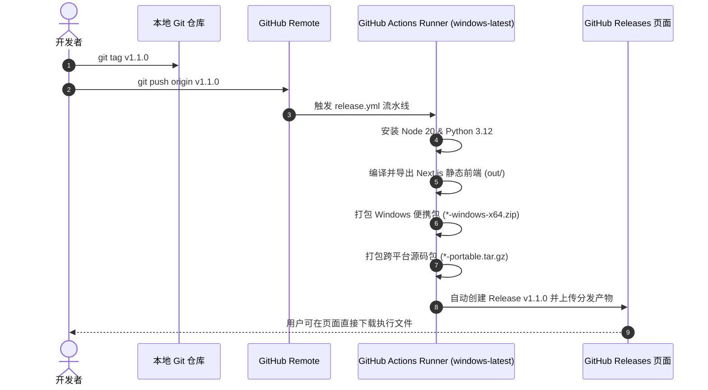

# AgentHub Local (本地多源算力中心与自主智能体工作台)

<p align="center">
  
  
  
  
  
  
  
  
</p>

> **数据与算力彻底解耦，告别单一模型绑定**：
> AgentHub Local 是专为极客与研发团队打造的**本地优先（Local-First）全场景智能体底座**。
> 所有会话历史、上下文快照、工作草稿、专属技能规程与长期记忆 100% 存留于本地原生 SQLite 数据库（WAL 并发模式 + FTS5 trigram 倒排全文检索）。无论接入本地私有大模型（Ollama、vLLM、Llama.cpp、Nvidia 实例），还是外部商业与开源 API（DeepSeek、Claude、OpenAI、SiliconFlow、Google AI），均充当无状态算力执行节点，零数据外泄，实现真正的个人私有化 AI 智能枢纽。

---

## 🚀 v1.1.0 重大架构演进 (What's New in v1.1.0)

从 `v1.0.0` 单会话工具升级至 `v1.1.0` 项目级工作区中枢 + 无人值守调度 + 具身自愈底座：



---

## 🌟 核心特性矩阵

### 1. 📂 通用工作区机制 (Workspace Hub & 物理目录绑定)
* **零业务硬编码**：全面支持用户自定义任意名称、任意业务属性的工作组（如 Web 全栈、自动化运维、法律/财务核算、个人知识库等）。
* **双模态工作区**：
  * **托管虚拟工作区**：用于临时问答与实验，数据安全存放于沙盒内；
  * **本地物理目录工作区**：直接挂载电脑上已有的代码或资料目录，**零迁移成本接入**。
* **物理 CWD 强锁定与防越界**：Agent 执行命令与写入文件严格锁定在工作区根路径下，禁止跨目录越界写；提供严格路径越界安全防御。
* **专属背景契约 (`WORKSPACE.md`)**：每个工作区可维护专属的技术栈规范或业务术语，AI 问答天然贴合项目语境。

---

### 2. 🔄 Loop 自主循环工程与防死循环熔断 (Loop Engineering)
* **`Planner -> Executor -> Verifier -> Reflector` 自驱状态机**：
  * **Planner**：自动拆解复杂目标为 DAG 子任务，实时同步写入 `<workspace>/.agenthub/scratchpad.md`；
  * **Executor**：在工作区物理路径下具身执行工具或命令；
  * **Verifier**：独立客观验收 (DoD 判定与返回码校验)；
  * **Reflector**：遭遇未通过或报错时自愈反思并调整策略。
* **错误指纹死循环熔断**：提取 `hash(error_type + error_message)` 错误指纹，**连续 3 次遭遇相同错误自动触发熔断保护**，杜绝死循环空转与 Token 浪费。
* **🧭 顶部 Loop 自主领航舱 (HUD)**：置顶展示子任务 DAG 步进、DoD 质检状态灯、当前迭代轮次，支持随时一键 `[暂停]`、`[继续]`、`[强停]`。

---

### 3. 🛡️ 三级敏感操作拦截网关与 HITL 人工审批 (PolicyInterceptor)
* 🟢 **L0（只读安全）**：文件读取、目录扫描、代码分析、无副作用查询 $\rightarrow$ 静默自动放行；
* 🟡 **L1（工作区受控写）**：在工作区物理路径内新建或修改文件 $\rightarrow$ 执行前自动在 `<workspace>/.agenthub/snapshots/` 创建轻量时间戳备份快照后放行；
* 🔴 **L2（高危拦截）**：跨目录越界写入、物理删除文件、不可逆破坏性 Shell 指令 $\rightarrow$ 挂起当前循环并呼出审批卡片：
  * **✅ 批准本次 (Approve Once)**：仅放行本次调用；
  * **🛡️ 本任务白名单 (Approve All)**：在当前任务生命周期内对该工具免密放行；
  * **✏️ 改参另存为 (Modify Args)**：人工在线修改参数并放行；
  * **❌ 拒绝并改道 (Reject & Reroute)**：驳回操作并附带引导建议，由 Reflector 重新规划。

---

### 4. ⚡ 本地物理目录零拷贝增量 FTS5 引擎 (Incremental FTS5)
* **智能规则过滤**：扫描前强制解析用户目录的 `.gitignore` 与 `.agenthubignore`，自动剔除 `node_modules`、`.git`、`dist`、超大日志及二进制文件；
* **增量水位线与防抖**：基于文件 `mtime + size + sha256` 维护水位线，仅对改动文件建立 trigram BM25 全文分词索引；
* **存储完全隔离**：索引统一存放于 `<workspace>/.agenthub/index.db`，绝不污染用户工程源码。

---

### 5. 🧩 双层 Skill 沙盒与同名高优 Override
* **L1 底座全局 Skill (`skills/`)**：随程序分发的通用环境体检、代码规范与文档助手；
* **L2 工作区私有 Skill (`<workspace>/.agenthub/skills/`)**：仅当前工作区可见，可随项目 Git 仓库协同提交；
* **同名覆盖法则**：L2 存在同名 Skill 时自动覆盖 L1，并在 UI 上标出 `[工作区重写]`；
* **`/` 快捷分层呼出与 SOP 抽屉**：输入框键入 `/` 即时呼出分组面板；点击 `[📖 SOP]` 在侧边抽屉滑出阅读明文 SOP 规程。

---

### 6. 📚 资产库统一归档与会话双向溯源 (LibraryView)
* **自动登记**：对话中使用 `[📥 一键落盘到工作区]` 或由 Loop 任务生成的文件、报表与可视化图表，自动向资产库登记元数据；
* **原生定位**：点击卡片一键唤起 Windows 原生资源管理器（`explorer /select`）高亮定位目标物理文件；
* **双向溯源**：资产可反查生成它的来源会话与 Prompt 历史。

---

### 7. ⏰ 无人值守计划任务中枢 (ScheduledView)
* **定时静默调度**：支持以 Cron 表达式或日常周期（daily、hourly、每周一等）定义计划任务；
* **桌面原生通知**：任务在后台执行完成后，自动调用 Windows 原生 Toast 桌面通知，实时提醒执行概况；
* **在线测试**：支持在控制台点击 `[立即测试]` 并在后台静默跑通全流程。

---

### 8. 🌍 全景四语种国际化 (i18n)
* 全量交互组件、工作区切换器、Loop 领航舱、审批卡片、SOP 抽屉及计划任务均已在 `i18nDictionary.ts` 中维护映射：
  * **简体中文 (zh-CN)**
  * **繁体中文 (zh-TW)**
  * **英语 (en)**
  * **日语 (ja)**

---

## 📦 多客户端离线包下载与运行

在 GitHub Releases 页面，我们为不同操作系统与使用场景提供了预编译离线包：

| 客户端版本 | 适用系统 | 包名称 | 运行方式 |
| :--- | :--- | :--- | :--- |
| **Windows 独立便携桌面版** | Windows 10/11 x64 | `AgentHub-Local-v1.1.0-windows-x64.zip` | 解压后双击 `启动AgentHub桌面版.bat` 即开即用 |
| **跨平台便携运行包** | macOS / Linux / Win | `AgentHub-Local-v1.1.0-portable.tar.gz` | 解压后执行 `python desktop_app.py` 或 `uvicorn` |
| **Docker 容器镜像** | 跨平台容器环境 | `docker-compose.yml` | `docker compose up -d` |

---

## 🛠️ GitHub Releases 自动打包机制 (CI/CD)

本项目配置了完整的 GitHub Actions 自动化打包流水线（`.github/workflows/release.yml`）：



### 如何发布新版本：
只需在本地执行以下三条命令：
```bash
git tag v1.1.0
git push origin master
git push origin v1.1.0
```
推送后，GitHub 会在云端全自动执行编译、矩阵打包并挂载 release 附件，几分钟内即可在 Releases 页面看到生成的下载文件！

---

## 💻 源码本地启动与开发

如果您希望从源码启动开发或调试：

### 1. 环境准备
- Python $\ge$ 3.10
- Node.js $\ge$ 18

### 2. 安装依赖
```bash
# 后端依赖安装
pip install -r requirements.txt

# 前端依赖安装
cd frontend
npm install
cd ..
```

### 3. 一键启动
```bash
# Windows 用户直接双击运行：
启动AgentHub桌面版.bat

# 或命令行方式启动原生桌面窗体：
python desktop_app.py
```

---

## 📄 开源许可证

本项目基于 [MIT License](LICENSE) 开源发布。
欢迎提交 Issue 与 Pull Request 共同完善 AgentHub Local 极客生态！
