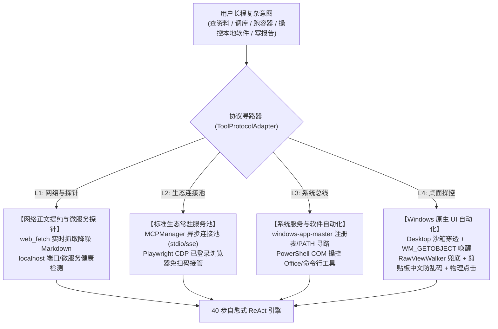

# GeminiHub Local (本地多账号智能算力中心与私有化研发工作台)

<p align="center">
  
  
  
  
  
  
</p>

> **数据与算力彻底解耦**：所有会话历史、上下文快照、工作草稿与长期记忆 100% 存留于本地原生 SQLite 数据库（WAL 模式 + FTS5 trigram 全文检索）。云端多账号与外部 API 仅充当无状态算力执行节点，零数据外泄，实现真正的个人私有化 AI 智能中枢。

---

## 🌟 核心架构与特性矩阵

### 1. 🧠 40 步长程自愈式 ReAct 双层微内核 (Autonomous Agent Runtime)
- **动态自愈与智能延展**：支持在单回合内从默认 16 步**自动延展至最高 40 步**，具备“报错不中断、自主看日志纠偏、动态调整策略”的深度闭环能力。
- **LoopBreaker 语义级死循环熔断器**：实时计算 `(tool, canonical_args)` 哈希，若连续 2 次或 5 步内 3 次发起完全相同的失败指令，立即阻断并注入最高优推偏指令，杜绝无效消耗算力。
- **PowerShell `-EncodedCommand` 转义免疫**：通过 UTF-16LE Base64 编码直接投递命令，彻底规避 Windows 下引号嵌套逃逸、`$_` 管道变量丢失与 `$LASTEXITCODE` 污染。
- **Intra-Turn 滚动微缩与主动草稿纸**：当前轮次仅保留最近 4 步完整工具执行结果，更早步骤自动收缩为极简快照；在第 4 步主动提醒同步工作记忆草稿纸，杜绝长程任务“中途失忆”。
- **流式半途断连自愈 (Stream EOF Mid-Flight Retry)**：底层集成网络断流重试协议与 `stream_reset` 信号，即使 Google 网关中途断开底层 TCP，也能无感重连续传。

---

### 2. 🌐 四层递进式外部交互协议矩阵 (4-Tier Interaction Protocol)
面对用户复杂任务，Agent 遵循工业级稳定性与速度最优路径，按四层协议自主寻路调用：



- **L1 网络探针 (`web_fetch`)**：免配置抓取指定 HTTP/HTTPS 网页并剥离广告转为 Markdown；秒级探测本地 localhost 端口与健康状态。
- **L2 生态服务池 (`MCPManager` + CDP)**：单例常驻保活，支持标准 MCP 协议（预置文件系统、SQLite、Playwright CDP）；自动接管本机已登录浏览器，免重复扫码。
- **L3 系统总线 (`windows-app-master`)**：通过注册表快速定位系统软件路径，利用原生 PowerShell 驱动系统后台服务。
- **L4 桌面 UI 自动化 (`ui_operator.py`)**：
  - **沙箱穿透**：通过 `OpenDesktopW("default", ...)` + `SetThreadDesktop` 跨越隔离沙箱，直接控制宿主交互桌面；
  - **无障碍唤醒**：向窗口发送 `WM_GETOBJECT` (0x003D) 与 `SPI_SETSCREENREADER` (0x0047)，强制唤醒新版微信 (Qt 5.15+)、Chrome、Electron 的内部 Accessibility DOM 树；
  - **双模提取与物理坐标**：标准 `FindAll` 优先，遇自绘断层自动切 `RawViewWalker` BFS 遍历，提取附带物理屏幕坐标 `rect='[x,y,w,h]'`；
  - **高保真输入与点击**：`ShowWindow(hwnd, 9)` 恢复置顶；文本输入通过 **`Set-Clipboard` + `^v` 暂存恢复**（雁过无痕且杜绝中文输入法截胡）；无 Pattern 控件自动计算中心点通过 `mouse_event` 触发物理点击，并声明 `SetProcessDPIAware` 确保 2K/4K 高分屏零偏移。

---

### 3. ⚡ 多源多协议算力调度中枢与双轨路由 (EnginePool)
- **Google 官方 PKCE OAuth（三合一接入）**：
  - **模式 A**：本地 `1455` 端口自动回环监听捕获；
  - **模式 B**：隔离环境/远程手动粘贴跳转后的回调 URL 兜底自动换取令牌；
  - **模式 C**：直接粘贴长期 `refresh_token` 或 JSON 凭据，自动验活并入库。
- **通用 OpenAI 兼容扩展端点**：
  - 内置 **DeepSeek 官方**、**硅基流动 (SiliconFlow)**、**本地 Ollama (`http://127.0.0.1:11434/v1`)**、**OpenRouter** 与 **Google Gemini API (官方 OpenAI 兼容层)** 5 大一键预设模板；
  - 提供实时连通性探测接口，自动测速（ms）并嗅探可用模型列表。
- **双轨任务分流 (0 主力额度损耗)**：
  - 主对话与复杂 ReAct 推理指定 `task_role="primary"`，调度主力高智商模型；
  - 后台 Rolling 浓缩与长期记忆提炼指定 `task_role="light"`，优先调度本地 Ollama、硅基流动或免费 Flash 节点；
  - 具备 **< 50ms** 429 智能自动接力与降级状态机。

---

### 4. 💡 纯本地三层记忆生命周期 (Long-Term Memory Hub)
- **短期消息链**：会话级轮次锚定 (`turn_id`)，历史工具输出微缩。
- **工作记忆草稿纸 (Scratchpad)**：跨步骤关键中间变量与未完成目标同步。
- **长期记忆画像引擎 (`long_term_memory`)**：
  - **幂等水位线游标 (`last_extracted_turn_id`)**：增量提炼未扫描轮次，杜绝重复提取；
  - **180 秒闲置异步防抖**：用户停顿 3 分钟后静默启动提纯，调度 `light` 算力提取偏好与环境事实；
  - **FTS5 BM25 冲突合并**：自动比对存量记忆，输出 `[ADD, UPDATE, NOOP]` 标准决策；
  - **30 天自然指数衰减**：未命中记忆按 $C_{\text{new}} = C_{\text{old}} \times e^{-0.03 \times (\Delta \text{days} - 30)}$ 衰减，低于 0.3 自动清理；**标记为 `is_pinned=1` 的核心规范绝对豁免衰减**；
  - 每次被召回时原子更新 `hit_count` 与 `last_accessed_at`。

---

### 5. 📥 跨平台历史数据「四步导入向导」与一键回滚 (Unified Importer)
- **全格式支持**：
  - **ChatGPT**：官方导出包 (`.zip` / `conversations.json` / `memories.json`)，算法基于叶子节点逆向沿 `parent` 回溯，完美展平为线性消息链；
  - **Claude**：`chat_messages` 映射会话导入；
  - **IDE 规则文件**：`GEMINI.md` / `CLAUDE.md` / `.cursorrules` 切块提取，默认赋予 `is_pinned=1` 与 0.95 高置信度。
- **可视化四步向导**：
  - 1. 选择来源/拖拽上传 ➔ 2. 选择范围偏好 ➔ 3. 记忆冲突高亮比对表 (`NEW` / `CONFLICT` / `DUPLICATE`) ➔ 4. `BEGIN IMMEDIATE` 批量事务落盘。
- **一键按批次无痕撤回 (Rollback)**：每个批次记录独立的 `batch_id`，支持一键级联清除该批次导入的所有会话、消息与长期记忆。

---

## 🏗️ 系统分层全景图

```
┌────────────────────────────────────────────────────────┐
│             GeminiHub Local 客户端交互层               │
│   (Next.js 14 + React + Tailwind CSS + WebView2 桌面)  │
│  ├─ 极速单次 / 标准对话 / Agent 任务三场景切换          │
│  ├─ 账号池与多源 API 监控面板 (测速 / 编辑 / 启停)     │
│  ├─ 长期记忆中枢 (Memory Hub) 与 置顶管理               │
│  └─ 跨平台四步数据导入向导 (Import Wizard)             │
└───────────────────────────▲────────────────────────────┘
                            │ 本地回环通信 (HTTP / SSE 流式传输)
┌───────────────────────────▼────────────────────────────┐
│                  FastAPI 微内核服务中枢                │
│  ├─ 40 步长程自愈 AgentRuntime (LoopBreaker + 防断流)   │
│  ├─ 四层外部交互总线 (Web / MCP / WindowsApp / UIA)    │
│  ├─ EnginePool 混合算力调度器 (主力/后台双轨路由)       │
│  ├─ LongTermMemoryManager (FTS5 + 180s防抖 + 30天衰减) │
│  └─ UnifiedImporter 跨平台解析与批次回滚引擎           │
└─────────────▲────────────────────────────▲─────────────┘
              │ 异步持久化                  │ 调度执行
┌─────────────▼─────────────┐ ┌────────────▼─────────────┐
│    本地数据源 (SQLite)    │ │   外部多协议算力执行通道  │
│  - WAL 高性能日志并发模式 │ │  - Google OAuth (PKCE)   │
│  - FTS5 trigram 全文索引  │ │  - DeepSeek / 硅基流动   │
│  - 纯本地存储、绝不上云   │ │  - 本地 Ollama / Claude  │
└───────────────────────────┘ └──────────────────────────┘
```

---

## 🚀 快速启动指南

### 方案 A：桌面原生客户端（推荐，开箱即用）

适用于 Windows 桌面日常使用，启动即享原生全屏工作台。

#### 1. 克隆代码库
```bash
git clone https://github.com/voodooq/geminihub-local.git
cd geminihub-local
```

#### 2. 准备 Python 虚拟环境并安装依赖
```powershell
# 创建虚拟环境 (建议 Python 3.10 或更高版本)
python -m venv .venv

# 激活虚拟环境 (Windows PowerShell)
.\.venv\Scripts\Activate.ps1

# 安装核心依赖
pip install -r backend/requirements.txt
```

#### 3. 一键启动
在项目根目录下**双击运行**：
- `启动GeminiHub桌面版.bat` （静默原生桌面模式）
- 或 `启动GeminiHub_调试模式(带控制台日志).bat` （带控制台实时滚屏日志）

也可以在终端中执行：
```powershell
.\.venv\Scripts\python.exe desktop_app.py
```
> **提示**：前端静态生产级产物已内置于 `frontend/out/`，启动时由桌面应用自动托管，无需安装 Node.js 即可直接使用！

---

### 方案 B：本地前后端分离调试运行（适合开发者二次开发）

如果您希望对前端或后端代码进行二次开发、热重载调试：

#### 1. 启动后端服务 (FastAPI)
```bash
cd backend
python -m uvicorn main:app --host 127.0.0.1 --port 8686 --reload
```
后端就绪后可访问交互式 API 契约文档：`http://127.0.0.1:8686/docs`

#### 2. 启动前端服务 (Next.js)
另起一个终端：
```bash
cd frontend
npm install
npm run dev
```
前端开发服务启动后，浏览器打开：`http://localhost:3000`

---

### 方案 C：Docker Compose 容器化部署（服务器 / 远程环境）

适合在 Linux 服务器或 NAS 上私有化部署。

```bash
# 复制环境变量配置
cp .env.example .env

# 一键启动容器集群
docker compose up -d --build
```

- 前端工作台访问：`http://<您的IP>:3000`
- 后端服务接口访问：`http://<您的IP>:8686`

---

## ⚙️ 环境变量配置 (`.env`)

复制根目录下的 `.env.example` 为 `.env` 可自定义各项参数：

| 配置项 | 默认值 | 说明 |
| :--- | :--- | :--- |
| `TZ` | `Asia/Shanghai` | 系统时区 |
| `LOG_LEVEL` | `INFO` | 日志级别 (`DEBUG` / `INFO` / `WARNING` / `ERROR`) |
| `DB_PATH` | `/app/data/gemini_hub_local.db` | SQLite 数据库文件绝对或相对路径 |
| `AUTO_FAILOVER_RETRY` | `3` | 429 限流重试容错阈值 |
| `DEFAULT_COOLDOWN_SECONDS` | `60` | 账号触发限流后的冷却锁定秒数 |
| `GOOGLE_OAUTH_CLIENT_ID` | *(空)* | 可选，自定义 Google Cloud OAuth Client ID |
| `GOOGLE_OAUTH_CLIENT_SECRET` | *(空)* | 可选，自定义 Google Cloud OAuth Client Secret |

---

## 🔒 隐私与安全性规范

1. **零数据上传与网络隔离**：系统默认仅监听 `127.0.0.1` 回环地址，所有数据与个人对话全部保存在本地 `data/` 目录的 SQLite 文件中。
2. **凭据安全处理**：
   - 绝不硬编码任何个人密钥或账号信息；
   - 敏感配置文件与本地日志已通过严格的 `.gitignore` 排除规则保护；
   - 支持动态在界面中配置私有 Google OAuth 凭据。
3. **安全审计追踪**：内置审计日志功能，记录所有核心操作与模型调用，方便回溯与排查。

---

## 📄 开源许可证

本项目基于 [MIT License](LICENSE) 开源协议分发与使用。
