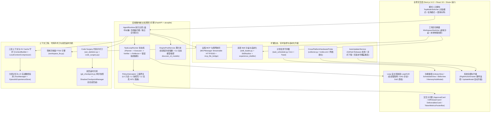
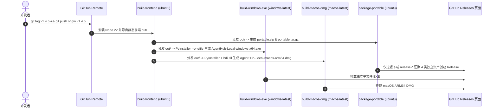

# AgentHub Local (本地多源算力中心与自主智能体工作台)

<p align="center">
  
  
  
  
  
  
  
  
  
</p>

> **数据与算力彻底解耦，告别单一模型绑定**：
> AgentHub Local（`v1.4.5 · Strata Edition`）是专为极客与研发团队打造的**本地优先（Local-First）全场景智能体底座**。
> 所有会话历史、上下文快照、工作草稿、专属技能规程与长期记忆 100% 存留于本地原生 SQLite 数据库（WAL 并发模式 + FTS5 trigram 倒排全文检索）。无论接入本地私有大模型（Ollama、vLLM、llama.cpp），还是外部商业与开源 API（DeepSeek、Claude、OpenAI、Google AI、Antigravity CLI），均充当无状态算力执行节点，零数据外泄，实现真正的个人私有化 AI 智能枢纽。

---

## 🏗️ 核心架构视图 (Architecture Overview)



---

## 🌟 核心技术方案与特性矩阵

### 1. ⚡ 多源算力池化、CLI 动态模型识别与全链路水表
* **多源无状态算力调度 (`EnginePoolService` · `gemini_client.py`)**：
  * 统一池化本地私有引擎（Ollama、vLLM、`llama.cpp` / `llama-server`）与云端 API（DeepSeek、Claude、OpenAI、Google AI、Antigravity CLI）。
  * 内置模型级 **180 秒冷却熔断锁**与地区网络受限 **300 秒隔离**，遭遇 429 或连续 503 自动切换备选通道；自适应 Kimi/Moonshot 等模型参数（如 `temperature=1`）。
* **CLI 账号模型动态嗅探与聚合 (`agent_runner.py` · `ModelSelector` · `SettingsModal`)**：
  * 新增 `discover_cli_models` 与 `parse_agy_models_output`，按活跃 CLI 账号隔离目录（`GEMINI_CLI_HOME`）实时执行 `agy models` 探测已解锁模型，自动过滤无权限模型。
  * 自动将多思考档位变体（`-low` / `-medium` / `-high` / `-xhigh`）聚合为主模型条目，保留无后缀单档位模型；`resolve_agy_model_flag` 支持动态变体映射与档位平滑回退，支持未来新模型免改代码自动识别。
  * 在「设置 → 模型」提供「刷新识别模型」按钮（对接 `GET /api/v1/models/active?refresh=true`），引入 `known_candidate_ids` 感知新解锁模型自动浮现。
* **全链路性能微水表 (`TokenMetricsFooterBar`)**：
  * 深度适配 `llama-server`（`/health`、`/props`、`/tokenize`、`timings`），每条回复底部渲染单行实时水表，展示上下文水位、KV Cache 命中率、脱水节省比例及 TTFT / TPS。

---

### 2. 📂 通用工作区机制与零拷贝增量 FTS5 引擎
* **双模态工作区 (`WorkspaceSwitcher`)**：
  * **托管虚拟工作区**：用于临时问答与实验，数据安全存放于隔离沙盒内。
  * **本地物理目录工作区**：直接挂载电脑上已有的代码或资料目录，**零迁移成本接入**。
* **物理 CWD 强锁定与专属契约 (`WORKSPACE.md`)**：Agent 执行命令与文件写入严格锁定在工作区根路径下，禁止跨目录越界写；支持为每个工作区维护 `WORKSPACE.md` 技术栈与业务术语契约。
* **零拷贝增量 FTS5 (`workspace_fts.py`)**：扫描前自动解析 `.gitignore` 与 `.agenthubignore`，基于 `mtime + size + sha256` 水位线防抖建立 trigram BM25 全文分词索引，索引独立存放于 `<workspace>/.agenthub/index.db`，绝不污染工程源码。

---

### 3. 🔄 Loop 自主循环工程与会话强隔离
* **`Planner -> Executor -> Verifier -> Reflector` 自驱状态机 (`loop_runner.py`)**：
  * **Planner** 拆解目标为 DAG 子任务并同步写入 `<workspace>/.agenthub/scratchpad.md`；**Executor** 具身执行；**Verifier** 进行 DoD 独立验收；**Reflector** 遇错自愈调整策略。
  * **错误指纹死循环熔断**：提取 `hash(error_type + error_message)`，连续 3 次遭遇相同错误自动触发熔断保护。
* **Loop 领航舱会话强隔离 (`LoopHUD`)**：
  * `GET /api/v1/loop/workspace/{ws_id}/active` 与前端 SSE 分发按 `conversation_id` 强隔离，切换对话或空白会话瞬间清零领航舱；采用三层纯闲聊判定与惰性建 Loop，纯文本闲聊彻底零触发、零闪烁。
* **需求澄清与自动升舱 (`InteractiveInquiryCard`)**：在对话模式下启用需求澄清后，支持分步确认引导（含 `Tab` 跳选占位模板）；用户点击批准计划或立即执行时，自动升舱为 Agent 执行态并物理落盘。

---

### 4. 🛡️ 三级敏感操作网关、HITL 审批与防卡死治理
* **三级敏感操作拦截网关 (`policy_interceptor.py` · `ApprovalCard`)**：
  * 🟢 **L0（只读安全）**：读取、扫描与无副作用查询 $\rightarrow$ 静默自动放行。
  * 🟡 **L1（工作区受控写）**：工作区内新建或修改文件 $\rightarrow$ 自动创建轻量快照后放行。
  * 🔴 **L2（高危拦截）**：跨目录越界写、物理删除、高危 Shell 指令 $\rightarrow$ 挂起循环并呼出四键审批卡片（**批准本次 / 本任务白名单 / 改参另存为 / 拒绝并改道**）。
* **CLI 原生工具越权自愈与长流抗卡死 (`agent_runner.py` · `shell_executor.py`)**：
  * 拦截 CLI 原生越权工具调用并触发 `cli_native_tool_denied`，在 `AgentRuntime` 内进行同轮最多 2 次无感盘中纠偏，引导模型回归标准 `<tool_call>` 协议。
  * `_AsyncLineReader` 配备 16 MiB 子进程缓冲区与 300,000 字符安全限流；`LocalShellExecutor` 对超过编码阈值的超长脚本（Windows `-EncodedCommand` > 24 KB / POSIX > 64 KB）自动转为临时 `.ps1`/`.sh` 文件执行并清理，彻底消除 `[WinError 206]`。

---

### 5. 🔪 Code Surgery 精准代码手术刀与 AST 语法门禁
* **Tree-sitter 代码大纲与语法门禁 (`tools/ast_skeleton.py`)**：
  * 轻量提取函数、类、方法签名与结构大纲，避免整文件读取浪费上下文；写盘前强制执行 `validate_syntax_before_write`（Python / JS / TS），阻断语法损坏写入。
* **带行号切片读取与三级容错局部补丁 (`tools/code_surgery.py`)**：
  * `read_local_file_sliced` 支持 `start_line` / `end_line` 窗口读取与 `123 |` 行号对齐。
  * `apply_search_replace_blocks` 支持多块 `<<<<<<< SEARCH ... ======= ... >>>>>>> REPLACE` 原子补丁，提供 **Level 1 精确匹配 $\rightarrow$ Level 2 缩进与空行容错对齐 $\rightarrow$ Level 3 相似度诊断提示**，并回传标准 Unified Diff。
* **行级红绿 Diff 卡片与一键撤销 (`DiffViewerCard`)**：前端直观渲染行级增删比对、快照 Tree Hash 与「一键撤销修改」交互按钮。

---

### 6. 🧠 三区上下文压缩、L5 实战微经验库与影子 Git 双回滚时光机
* **三区上下文工程与 KV Cache 守护 (`context_builder.py` · `context_compressor.py`)**：
  * 物理划分 **Zone 1（恒定不动前缀）+ Zone 2（只增不改热区 + 分块坍缩）+ Zone 3（跨轮零残留尾注）**，结合 36k 云端软上限、44K/48K CLI 防爆阀、同路径历史写入折叠与两级漏斗脱水（超长工具输出转为 `ToolRef` + `read_tool_ref` 按行回查），最大化 KV Cache 命中率。
* **四层记忆体系与 L5 静默实战微经验库 (`experience_store.py` · `fact_manager.py` · `long_term.py`)**：
  * 整合滑动窗口摘要（`session_summary.py`）、双时间轴确定性事实（`FactManager`）、180s 闲置水位锁长时提炼（`long_term.py`）与只增不改行为账本（`ledger.py`），全程经 `MemoryPolicyGuard`（`policy_guard.py`）脱敏凭据。
  * **L5 `EpisodicExperienceStore`**：基于 SQLite `FTS5 trigram` 与**三路正交锚点（实体标签 + 报错特征码 + 口语同义词簇）**，在 Zone 3 按阈值分级注入（`>= 0.80` 强采纳、`0.65~0.80` 参考提示、`< 0.65` 过滤）；工具遇错时即时检索避坑解法；回合结束后静默提炼微经验并执行复用加权（`+0.03`）与失败降权（`-0.15`）达尔文淘汰。
* **影子 Git 双回滚时光机与 0-Token 斜杠指令 (`git_checkpoint.py` · `checkpoint_manager.py`)**：
  * **单步快照**：`git_checkpoint.py` 通过 `agenthub_shadow.index` 毫秒级生成 40 位 Tree Hash 快照，配合 `POST /api/v1/workspaces/{id}/rollback` 一键单步还原。
  * **全会话时光机**：`ShadowCheckpointManager` 在 `<workspace>/.agenthub/shadow_git` 维护独立镜像仓库，支持 `/ckpt`、`/rollback`、`/remember`、`/distill` 零 Token 斜杠管理命令，`/rollback` 可原子回滚磁盘源码、草稿纸、SQLite 消息与行为账本。

---

### 7. 🧩 双层多 Skill 协同沙盒与无错门控自进化
* **双层隔离与极速加载 (`skill_loader.py` · `SkillsView` · `SopDrawer`)**：
  * 支持 **L1 全局底座 Skill（`skills/`）** 与 **L2 工作区私有 Skill（`<workspace>/skills/` 与 `<workspace>/.agenthub/skills/`）**，L2 同名自动覆盖 L1 并标注 `[工作区重写]`。
  * 采用 4KB Frontmatter 摘要 + 前端 SWR 缓存实现 `/` 秒开，点击 `[SOP]` 按需懒加载完整规程；单条指令支持多次 `/` 串联多 Skill 协同执行。
* **供应链安全审计与无错沉淀门控 (`skill_auditor.py` · `experience_distiller.py`)**：
  * 导入三方 Skill 时通过 `SkillAuditor` 遍历 AST，阻断 `os.system`、`subprocess`、`eval`、硬编码密钥与越狱注入。
  * `evaluate_skill_distill_eligibility` 严格拦截未完成或末尾带报错的残缺轨迹，仅完整无错工作流开放沉淀，并自动抽取 `Troubleshooting / 避坑注意事项`；支持同名 Skill 语义化版本（`patch`/`minor`）原子迭代，完整保留既有 `knowledge/` 自定义文档。

---

### 8. 🌐 远程 MCP 协议全栈支持与跨网安全文件协同
* **全协议 MCP 接入 (`mcp_manager.py` · `MemoryHubModal`)**：
  * 在本地 `_StdioMCPConnection` 基础上原生扩展 `_RemoteHttpMCPConnection`，全面支持 **`Streamable HTTP`**（含 `Mcp-Session-Id` 有/无状态连接、404 自动重连与异步 `DELETE` 清理）及 **`Legacy HTTP + SSE`**（强制同源校验与禁止跨站重定向防凭据泄露）。
  * 兼容 Claude Desktop（`mcpServers`）、VS Code（`servers`）与 Windsurf（`serverUrl`）配置格式导入，支持 `${ENV_VAR}` 运行时环境变量展开与 Headers 密钥脱敏掩码保护。
* **跨网安全文件协同桥接 (`mcp_file_bridge.py`)**：
  * 提供 `mcp_upload_workspace_file` 与 `mcp_download_artifact_to_workspace` 通用工具：上传支持自定义表单字段 `upload_file_field` 与体积校验；下载采用 `aiter_bytes()` 真流式体积熔断、严格 `2xx` 与反误写校验，落盘后自动注册资产库。

---

### 9. 📚 资产库归档、磁盘物理核验与独立交付呈现
* **反伪落盘幻觉与物理存在性核验 (`artifacts.py` · `AgentRuntime` · `DeliverablesCard`)**：
  * 拦截无工具纯叙事宣称已写入却未真实落盘的幻觉（触发 `stream_reset` 纠偏）；新增 `POST /api/v1/artifacts/verify-paths` 批量核验工作区文件真实大小与修改时间，零落盘气泡绝不渲染误导性绿色交付卡片。
  * 强制分离「执行过程」与「最终交付正文」，防止 `update_working_memory(task_completed=true)` 导致交付正文混入折叠区，并在底栏渲染「生成文件直达」卡片。
* **沙盒隔离上传与双向溯源 (`attachment_service.py` · `LibraryView`)**：上传文件按 SHA-256 去重隔离于 `.agenthub/attachments/`；资产库支持一键唤起系统资源管理器高亮定位物理文件，并支持反查来源会话与 Prompt。

---

### 10. 🖥️ 系统实时硬件监控与智能治理中枢
* **跨平台实时硬件探针 (`probe/collector.py` · `RightActionDrawer`)**：
  * 打开右侧「系统实时监控与智能治理」抽屉后，每 3 秒自动轮询 `/api/v1/system/snapshot`，实时展示 CPU 使用率/核数/主频、物理内存与 Swap、全分区磁盘占用及 Top 6 高占用进程。
  * `collector.get_gpu_metrics` 接入无窗口 `nvidia-smi` CLI 探测（原生适配 Windows/Linux NVIDIA 显卡负载、显存与核心温度）；新增 `get_network_metrics` 计算真实实时上/下行吞吐速率与累计流量（GB）。
  * 集成一键体检高占用进程、进程「提请治理」、端口占用排查及待审批系统治理/经验复盘清单交互闭环。

---

### 11. ⏰ 无人值守计划任务与全景四语种国际化 (i18n)
* **后台计划任务 (`task_scheduler.py` · `ScheduledView`)**：支持 Cron 表达式与日常周期调度，支持 `[立即测试]` 静默跑通，任务完成后自动调用 Windows 原生 Toast 桌面通知。
* **四语种国际化 (`i18nDictionary.ts`)**：全量界面与交互组件原生支持 **简体中文 (zh-CN)**、**繁体中文 (zh-TW)**、**英语 (en)**、**日语 (ja)**。

---

## 📦 多客户端无版本号发行包与自动升级

### 1. 预编译离线发行包
在 GitHub Releases 页面，我们为不同操作系统与使用场景提供预编译产物（自 `v1.4.2` 起，桌面端单文件与 DMG 镜像全面采用**无版本号文件名**，消除跨版本升级后本地残留旧版本号的歧义）：

| 客户端版本 | 适用系统 | 包名称 | 运行方式 |
| :--- | :--- | :--- | :--- |
| **Windows 独立单文件桌面版** | Windows 10/11 x64 | `AgentHub-Local-windows-x64.exe` | 免安装免解压，单文件双击直接运行（同级目录存数据，无权限时存 `%LOCALAPPDATA%\AgentHubLocal`） |
| **macOS 独立桌面安装版** | macOS Apple Silicon (ARM64) | `AgentHub-Local-macos-arm64.dmg` | 打开镜像将 `AgentHub.app` 拖入 `Applications`；首次运行如遇未签名提示，右键「打开」或在终端执行 `xattr -cr /Applications/AgentHub.app` |
| **轻量便携包（Windows / 通用）** | Windows / 跨平台 | `AgentHub-Local-v1.4.5-portable.zip` | 不含 Python 二进制运行库（约 `~2.2 MB`），解压装好 `requirements.txt` 后运行 `启动AgentHub桌面版.bat` |
| **轻量便携包（macOS / Linux）** | macOS / Linux | `AgentHub-Local-v1.4.5-portable.tar.gz` | 不含 Python 二进制运行库（约 `~2.2 MB`），解压装好依赖后运行 `./启动AgentHub桌面版.sh` |
| **Docker 容器镜像** | Linux 服务器 / 跨平台容器 | `docker-compose.yml` / `backend/Dockerfile` | 见下方 [Linux 服务器 Docker 部署与远程访问指南](#-linux-服务器-docker-部署与远程访问指南) |

### 2. GitHub 自动检查升级与平滑覆盖重启 (`AutoUpdaterService` · `UpdateModal`)
* **静默检查与更新提醒**：客户端启动时自动静默检查 `voodooq/agenthub-local` 最新 Release（亦支持在「设置 → 关于」手动检查），发现新版本后在侧栏与顶栏展示提醒徽标，并在 `UpdateModal` 中渲染 Markdown 升级日志。
* **流式下载与无版本号平滑落位**：点击「立即升级」自动匹配当前平台产物并流式下载，实时展示百分比进度、已下载体积与速率；内置 `.version` 缓存标记校验防止同名包跨版本复用旧缓存，并通过 `normalize_windows_target_exe` 在从历史带版本号 EXE 升级时自动重命名为 `AgentHub-Local-windows-x64.exe`。
* **数据零覆写重启**：通过 `/api/v1/system/update/*` 接口编排一键重启替换加载新版本，严格保护 `data/` 数据库与用户个人配置不被覆写。

---

## 🛠️ GitHub Releases 自动打包机制 (CI/CD)

本项目配置了跨平台并行 GitHub Actions 自动化打包流水线（`.github/workflows/release.yml`）：



### 如何发布新版本
只需在 `version.json` 更新版本号并运行 `python sync_version.py`（或直接运行 `python sync_version.py <version>`），随后在本地执行以下命令：
```bash
git tag -a v1.4.5 -m "Release v1.4.5"
git push origin master
git push origin v1.4.5
```
推送后，GitHub 会在云端全自动执行编译、矩阵打包并挂载 4 类干净的发行资产，几分钟内即可在 Releases 页面看到生成的下载文件。

---

## 💻 源码本地启动与开发指南

如果您希望从源码启动开发或调试：

### 1. 环境准备
* Python $\ge$ 3.10
* Node.js $\ge$ 18

### 2. 安装依赖
```bash
# 后端依赖安装
pip install -r requirements.txt

# 前端依赖安装
cd frontend
npm install
cd ..
```

### 3. 启动方式
```bash
# Windows 用户直接双击运行（或带控制台日志的调试模式）：
启动AgentHub桌面版.bat
启动AgentHub_调试模式(带控制台日志).bat

# macOS / Linux 用户运行：
./启动AgentHub桌面版.sh

# 或直接使用 Python 启动原生桌面窗体：
python desktop_app.py
```

---

## 🐳 Linux 服务器 Docker 部署与远程访问指南

如果您申请了在线 Linux 虚拟主机（VPS / 云服务器），推荐使用 Docker 方式部署后端与内置静态前端（仓库 `frontend/out/` 已预构建完整静态产物，可由后端 FastAPI 直接挂载托管）。

### 1. 服务器环境准备
确保 Linux 主机已安装 **Docker Engine** 与 **Docker Compose v2** 插件：
```bash
docker --version
docker compose version
```

### 2. 拉取代码并准备数据与配置
```bash
git clone https://github.com/voodooq/agenthub-local.git
cd agenthub-local

# 拷贝环境变量模板（按需修改 TZ、代理或故障转移参数）
cp .env.example .env

# 创建本地持久化目录与 CLI 账号目录
mkdir -p data ~/.agenthub/accounts
```

### 3. 一键构建并启动容器（Docker Compose 单容器全栈托管）
仓库根目录 `docker-compose.yml` 已配置为单容器全栈托管模式（自动挂载 `frontend/out` 静态产物至 `/app/static`，由后端 FastAPI 统一提供 Web UI 与 `/api/*` 服务，占用更低、无需额外前端容器）：

```bash
# 首次构建镜像并后台启动
docker compose up -d --build
```

> **提示**：
> - 若您的 Linux 主机需要通过网络代理访问外部大模型 API，可在 `.env` 中配置 `HTTP_PROXY` 与 `HTTPS_PROXY` 后执行 `docker compose up -d` 自动注入。
> - 若需拉取新版本代码并更新容器（`./data` 中的 SQLite 数据库与记忆完整保留）：
>   ```bash
>   git pull
>   docker compose up -d --build
>   ```

### 4. 安全远程访问方式（关键）
为防范 DNS 重绑定攻击与未授权访问，后端安全中间件（`LocalOnlyMiddleware`）**仅允许 `Host` 为 `localhost` / `127.0.0.1`**，且容器端口默认仅监听服务器回环地址 `127.0.0.1:8686`（**严禁直接将 8686 端口裸露到公网防火墙**）。

- **方式 A：SSH 端口转发隧道（最推荐，零公网暴露风险）**
  在您**本地电脑**的终端中执行：
  ```bash
  ssh -N -L 8686:127.0.0.1:8686 root@<您的Linux服务器IP>
  ```
  保持该终端运行，随后直接在本地电脑浏览器打开：**`http://127.0.0.1:8686`** 即可使用，系统会自动完成本机令牌（`X-Access-Token`）握手。

- **方式 B：Nginx 反向代理 + HTTPS（需公网域名访问时）**
  若必须通过公网域名访问，请务必在 Nginx 上启用 HTTPS 与 Basic Auth 访问控制，并将转发 `Host` 头重写为 `127.0.0.1`（同时开启 SSE 流式响应所需的 `proxy_buffering off`）：
  ```nginx
  location / {
      proxy_pass http://127.0.0.1:8686;
      proxy_set_header Host 127.0.0.1:8686;
      proxy_set_header X-Real-IP $remote_addr;
      proxy_buffering off;
      proxy_cache off;
      proxy_read_timeout 600s;
  }
  ```

### 5. 常用运维与排错命令
```bash
# 查看运行日志（含启动生成的 X-Access-Token 与模型探测状态）
docker compose logs -f

# 查看容器状态或重启服务
docker compose ps
docker compose restart

# 进入容器内部调试或登录 Gemini CLI 账号
docker compose exec backend bash
```

---

## 🧭 版本演进总览

### 🚀 v1.4.5（最新）— 计划任务启动即巡检与动态默认模型自适应
- **后端启动自动激活 Cron 调度器（`backend/main.py`）**：在 FastAPI `lifespan` 启动钩子中自动调用 `TaskScheduler.get_instance().ensure_started()`，无需手动点开「已安排」页面即可全天候按 Cron 自动触发任务。
- **无头任务动态模型自适应（`TaskScheduler._resolve_headless_model`）**：在工作区未单独指定模型时，自动按“工作区有效偏好 → 最近活跃会话模型 → 系统当前已启用算力通道默认/首个模型”智能选模，彻底解决仅配置第三方/本地算力（如 NVIDIA、DeepSeek、Ollama）而未配置 Google 账号时无法执行计划任务的问题。

### 🚀 v1.4.4 — Token 优化 Phase 2/3（协议/规则瘦身、动态思考、读去重、旁路门控与防空转拦截）
- **S4（静态前缀与规范瘦身，`tool_protocol` · `context_builder` · `skill_loader`）**：
  - `build_xml_protocol_prompt()` 改用高密度紧凑签名格式并新增 `build_single_tool_schema_hint()`（参数出错时自动回补该单工具完整 JSON Schema）；重构 Agent 铁律与 `plan_first` 提示词；拆分 `get_skill_dev_spec_prompt()` 仅在命中技能/MCP 开发意图时按需注入，常规 Agent 轮次实测固定前缀节省 ~3,788 tokens。
- **S6（ReAct 步内动态思考档位调节，`runtime`）**：
  - 新增 `_resolve_step_thinking_level()`：常规顺畅推进步降载为 `medium`，最终汇总步与纯简单问答降载为 `low`；一旦发生空回复、解析失败或工具报错立即锁回 `high`。
- **S7（读文件去重与终端输出前置降噪，`runtime` · `shell_executor`）**：
  - 新增基于磁盘 `mtime_ns + size` 与热区窗口校验的 `session_file_read_cache` 读文件去重指针；`shell_executor` 新增 `_sanitize_terminal_output()` 零成本剥离 ANSI 颜色码、`\r` 覆盖进度条行及连续空行。
- **S8（旁路记忆启发式前置门控，`long_term` · `experience_distiller`）**：
  - 180s 闲置记忆提取增加偏好/配置信号词门控；无自愈且无人工纠偏的纯多步任务直接走规则字段落盘，免调后台 LLM。
- **S10（无写操作穿插的重复调用拦截护栏，`runtime`）**：
  - 轮内连续重复发起相同只读/失败工具调用时直接拦截提示换路，发生写操作或状态变更立即清空窗口。

### 🚀 v1.4.3 — Token 优化 Phase 1（KV Cache 连续性与 MCP 按需加载）、Linux/Docker 自动更新及计划任务真调度执行
- **Token 优化 Phase 1（`context_builder` · `context_compressor` · `runtime` · `tool_protocol` · `engine_pool` · `provider_adapter` · `mcp_manager`）**：
  - **S1（Zone 2 严格 Append-Only）**：热区渲染统一保持 Write-Once 一致性，取消常规跨轮突变为 `compressed_content` 与逐轮折叠 `write_local_file`，仅在分块坍缩或逼近硬上限时批量折叠，修复跨轮 KV Cache 击穿。
  - **S2（轮内前缀稳定 + Anthropic Prompt Caching）**：`is_forced_final_step` 保留 `active_tools` 锁死 Zone 1 并拦截出站 `<tool_call>`；生图指引与确定性 `rand_seed` 迁至 Zone 3；`stream_anthropic` 自动注入 `cache_control: {"type": "ephemeral"}`（遇 400 自动降级记忆节点）。
  - **S3（MCP 两段式目录与按需 Schema 延迟挂载）**：启用 MCP 工具超过 5 个时默认仅注入轻量目录摘要，通过内置元工具 `discover_mcp_tools` 及关键词/历史/直调单调递增激活 Server，大幅削减空闲 Schema Token 消耗。
- **Linux 与 Docker 自动更新全链路打通（`AutoUpdaterService` · `UpdateModal` · `docker-compose.yml`）**：
  - 新增 `is_running_in_docker()`、`detect_docker_update_capability()`、`_apply_docker_archive()`（精准映射 `backend -> /app`、`frontend/out -> /app/static` 及原地覆写 `version.json`）与 PID 1 优雅退出交由 `restart: unless-stopped` 自动拉起；完善 `.tar.gz` 解压保留 `.sh` `+x` 权限与 Linux 便携/源码 `uvicorn` 平滑重启。
  - 移除 `docker-compose.yml` 中 `/app/static` 与 `/app/version.json` 的 `:ro` 只读限制，并在 `UpdateModal` 中适配 Docker 运行形态与只读挂载检测提示。
- **计划任务真实 Cron 调度、无头执行与状态详情（`TaskScheduler` · `scheduled` · `ScheduledView`）**：
  - 实现纯 Python 标准 5 段 Cron 解析（含 `*`、`*/n`、`a-b`、`a,b` 及 `@hourly`/`@daily` 等别名）与 `start_loop()` 防同分钟重入自动巡检；`run_task()` 真实无头调用 `agent_runtime.chat_stream`，捕获 `running` / `success` / `failed` 状态、耗时与完整输出落库至 `scheduled_task_runs`。
  - 新增 `GET /api/v1/scheduled/{task_id}/runs` 接口；前端 `ScheduledView` 升级为展示状态徽章、上次/下次运行时间、耗时及完整执行历史详情弹窗。

### 🚀 v1.4.2 — 系统实时硬件监控与治理中枢、NVIDIA/网络吞吐探针及无版本号安装包
- **实时硬件全景监控与多维度探针（`collector` · `RightActionDrawer`）**：
  - 将右侧抽屉重构为「系统实时监控与智能治理」面板：打开后每 3 秒自动轮询 `/api/v1/system/snapshot`，实时呈现 CPU 使用率/核数/主频、物理内存占用与 Swap、GPU 负载/显存占用/核心温度、网络实时上/下行吞吐速率及累计流量（GB）、全部分区磁盘使用率，以及 Top 6 高占用进程列表。
  - 在 `collector.get_gpu_metrics` 中接入无窗口 `nvidia-smi` CLI 兜底探测以原生适配 Windows/Linux NVIDIA 显卡；新增 `get_network_metrics` 计算两次采样窗口间的真实收发速率。
  - 集成一键体检高占用进程、进程「提请治理」、端口占用排查及待审批系统治理/经验复盘清单交互闭环。
- **无版本号桌面安装产物与平滑自动升级（`build_release_exe` · `AutoUpdaterService`）**：
  - Windows 单文件客户端与 macOS 安装镜像统一采用无版本号文件名 `AgentHub-Local-windows-x64.exe` 与 `AgentHub-Local-macos-arm64.dmg`，避免跨版本升级后本地文件名残留旧版本号产生歧义；发行构建脚本自动生成纯净默认 `mcp_servers.json` 种子，防止本地测试配置泄漏。
  - 自动更新服务新增 `normalize_windows_target_exe`（从历史带版本号 EXE 升级时自动落位并重命名为无版本号文件名）与 `.version` 缓存标记校验（防止同名包跨版本复用旧缓存）。

### 🚀 v1.4.1 — CLI 账号模型动态识别、Gemini 4 Hydrogen / Orchestrator 适配与一键同步
- **基于 CLI 账号动态嗅探与聚合可用模型（`agent_runner` · `models`）**：
  - 新增 `discover_cli_models` 与 `parse_agy_models_output`，按当前活跃 CLI 账号隔离目录（`GEMINI_CLI_HOME`）与系统代理自动执行 `agy models` 实时探测已解锁模型，自动过滤无权限模型（如未解锁的 `Gemini 4 Carbon`）。
  - 自动将多思考档位变体（`-low` / `-medium` / `-high` / `-xhigh`）聚合为主模型条目（如 `Gemini 4 Hydrogen`），并原样保留无思考后缀或单档位模型（如 `Orchestrator (Argon)` / `gemini-pro-orchestrator-g1-pro`、`GPT-OSS 120B`），同时支持未知未来新模型免改代码自动识别。
- **动态 `--model` 参数解析与新模型自动浮现（`agent_runner` · `gemini_client` · `models`）**：
  - `resolve_agy_model_flag` 优先匹配动态变体映射表并支持档位缺失平滑回退；补齐 `Gemini 4 Hydrogen` 与 `Orchestrator (Argon)` 的 Cloud Code / REST 映射。
  - 引入 `known_candidate_ids` 快照感知机制，CLI 升级或账号解锁新模型后自动浮现至输入框选择器，同时严格尊重用户手动取消勾选的偏好。
- **设置页一键刷新识别交互（`SettingsModal` · `ModelSelector`）**：
  - 在「设置 → 模型」页面新增「刷新识别模型」按钮（对接 `GET /api/v1/models/active?refresh=true`），支持随时穿透缓存同步当前 CLI 账号最新模型列表。

### 🚀 v1.4.0 — 远程 MCP 协议全栈支持、跨网文件协同与 GitHub 自动升级加载
- **远程 MCP 协议原生接入（`MCPManager` · `MemoryHubModal` · `SkillLoader`）**：
  - 全面支持 `Streamable HTTP`（含可选 `Mcp-Session-Id` 有/无状态连接、404 会话自动重连与 `close()` 异步 `DELETE` 清理）及 `Legacy HTTP + SSE`（强制同源校验与禁止跨站重定向防凭据泄露）。
  - 全面兼容公共与第三方标准 MCP 服务及多格式配置导入（Claude Desktop `mcpServers` / VS Code `servers` / Windsurf `serverUrl`）；新增服务名规范校验、Headers 密钥脱敏掩码保护与 `${ENV_VAR}` 运行时环境变量展开；全链路异步化 `shutdown_all()`。
- **跨网安全文件协同桥接（`mcp_file_bridge` · `LocalContextCompressor` · `ToolProtocolAdapter`）**：
  - 新增 `mcp_upload_workspace_file` 与 `mcp_download_artifact_to_workspace` 通用跨网协同工具：上传支持可配置表单字段名 `upload_file_field`（默认 `file`）与大小校验；下载采用 `aiter_bytes()` 真流式体积熔断、严格 `2xx` 与反误写校验，落盘后自动注册资产库。
  - 上下文旁路压缩对 `mcp__*` 工具放宽脱水阈值并保护结构化 URL 不被误截断；同步将协同工具纳入 `ToolProtocolAdapter` 核心工具与裸 JSON 兜底匹配。
- **GitHub Releases 自动检查升级、进度条下载与重启加载（`AutoUpdaterService` · `UpdateModal`）**：
  - 客户端启动自动静默检查 `voodooq/agenthub-local` 最新 Release 并支持手动检查；发现新版本时在侧栏与顶栏展示提醒徽标，并在弹窗中渲染 Markdown 升级日志（Release Notes）。
  - 点击「立即升级」自动匹配当前平台产物（Windows 单文件 EXE / macOS DMG / Portable 便携包）流式下载，实时展示百分比进度条、已下载体积与速率；下载完毕后提示并支持一键重启替换加载新版本（严格保护 `data/` 与个人配置不被覆写）。

### 🛡️ v1.3.x — 代码手术刀、L5 微经验与影子 Git 双回滚、会话强隔离及物理真实核验
- **Code Surgery 与单步快照回滚（`v1.3.0 ~ v1.3.1`）**：引入 Tree-sitter 代码大纲提取与 AST 语法门禁（`validate_syntax_before_write`）、行号切片读取、`apply_search_replace_blocks` 三级容错局部补丁、行级红绿 `DiffViewerCard`、`SkillAuditor` 静态安全审计，以及基于 `agenthub_shadow.index` 的毫秒级 Git Shadow 单步回滚。
- **L5 实战微经验库与全会话影子 Git 时光机（`v1.3.2`）**：落地 `EpisodicExperienceStore`（SQLite `FTS5 trigram` + 三路正交锚点 + 阈值分级注入 + 复用奖惩淘汰）、`ShadowCheckpointManager`（`.agenthub/shadow_git` 独立镜像仓库），以及 `/ckpt`、`/rollback`、`/remember`、`/distill` 零 Token 斜杠指令集。
- **Loop 会话隔离、交付分离与防伪落盘物理核验（`v1.3.3 ~ v1.3.6`）**：实现 `LoopHUD` 按 `conversation_id` 强隔离与三层纯闲聊零触发；建立 `evaluate_skill_distill_eligibility` 无错沉淀门控与语义化版本原子迭代；强制分离执行过程与独立最终交付气泡；接入 CLI 原生工具越权盘中自愈、超长命令临时脚本防 `[WinError 206]` 兜底、历史库平滑守护与 `POST /api/v1/artifacts/verify-paths` 磁盘物理存在性真实核验。

### ✨ v1.2.x — 三区上下文与 KV Cache 守护、性能微水表及多源算力稳定化
- **三区上下文压缩与两级漏斗脱水**：确立 Zone 1（恒定前缀）/ Zone 2（只增不改热区 + 36k 软上限坍缩）/ Zone 3（零残留尾注）物理隔离，配合工具长输出 `ToolRef` 旁路脱水与 `180s` 闲置记忆提炼水位锁，最大化本地与云端 KV Cache 命中率。
- **`llama-server` 深度适配与全链路 Token 水表**：原生接入 `llama.cpp`（`/health`、`/props`、`/tokenize`、`timings`），渲染单行实时水表（上下文水位、KV 命中率、TTFT/TPS）与 `/stats` 分角色消耗看板。
- **多源算力熔断与体验升级**：引入模型级 `180s` 熔断冷却锁与 `300s` 地区隔离，支持需求澄清自动升舱落盘、多 Skill 串联协同、长文本半屏编辑与执行步骤单行折叠。

### 🚀 v1.1.x — 项目工作区中枢、Loop 自主循环、四层记忆治理与跨平台发布体系
- **通用工作区与增量 FTS5**：支持虚拟沙盒与本地物理目录零迁移挂载、`.gitignore` 过滤增量 trigram 索引、4KB Frontmatter + SWR 技能秒开及 `L1/L2` 同名覆盖。
- **Loop 自主循环与 HITL 审批网关**：落地 `Planner -> Executor -> Verifier -> Reflector` 状态机、错误指纹 3 次熔断、Plan-First 引导向导与 `L0 / L1 / L2` 三级敏感操作四键审批网关。
- **记忆治理与跨平台打包**：构建基于本地 SQLite 的四层记忆体系（`FactManager` 双时间轴事实、事件账本与凭据脱敏）、沙盒隔离上传、资产库双向溯源及 GitHub Actions 跨平台自动打包流水线。

### 🌱 v1.0.x — 本地多源算力解耦与自主智能体底座奠基
- **算力与数据完全解耦**：确立原生 SQLite WAL + FTS5 纯本地持久化架构，支持本地私有推理引擎（Ollama / vLLM / llama.cpp）与商业/开源 API 统一池化管理。
- **桌面级私有工作台基座**：完成 FastAPI 后端、Next.js 静态前端与原生桌面窗口集成，奠定多会话持久化、流式工具调用、本地终端安全执行、Skill/MCP 扩展及中/繁/英/日四语种国际化底座。

---

## 📄 开源许可证

本项目基于 [MIT License](LICENSE) 开源发布。
欢迎提交 Issue 与 Pull Request 共同完善 AgentHub Local 极客生态！
