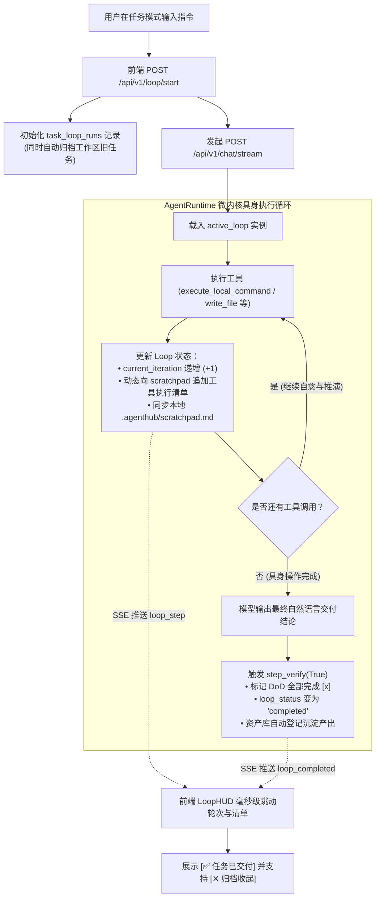

# Loop 自主领航舱具身联动与闭环状态机实施方案

## 一、问题背景与根因定位
用户反馈在工作区任务模式下，顶部的 **LOOP 自主领航舱 (LoopHUD)** 始终显示：
- `具身执行中`
- `轮次 0/10`（轮次停滞不增）
- 清单停留在第 2 步 `[/] 2. 核心逻辑执行与测试用例验证`
- 即使多轮对话和具身工具（如终端命令）全部执行完毕，状态依然不更新，处于“假死”状态。

### 根本原因剖析
1. **执行状态双向脱节**：前端通过 `/api/v1/loop/start` 初始化了 `task_loop_runs` 数据，但底层的具身执行内核 `AgentRuntime.chat_stream` 独立运行，完全没有注入或回写 `TaskLoopRepository`，执行命令时从未更新 `current_iteration` 和 `scratchpad_md`。
2. **缺少自动闭环验收机制 (Auto-Completion & DoD Verifier)**：流式对话结束且无后续工具调用时，未触发 `step_verify(True)`，Loop 永远保持 `executing`，数据库中堆积未完结任务。
3. **多轮任务目标冲突与旧任务悬空**：用户在同一工作区发起多轮交互时，旧 Loop 悬挂未归档，新 Loop 重新从 0 启动且继续假死。
4. **前端仅靠低频轮询，缺少 SSE 事件即时反馈**：前端依赖 4 秒一次的接口轮询，无法实时感知具身命令步进。

---

## 二、架构改造方案

---

## 三、详细修改清单
1. **`backend/app/repository/loop_run_repository.py`**：
   - 在 `create_loop` 时，将当前工作区所有旧的未完成 Loop 状态自动更新为 `completed`（避免孤儿任务挂起）；
   - 新增 `get_latest_loop_by_workspace`，确保任务完成（`completed`）后仍能向前端展示交付状态；
   - 增加 `record_tool_step` 方法，支持快速追加工具执行历史并更新当前轮次。
2. **`backend/app/agent/runtime.py`**：
   - 在 `chat_stream` 初始阶段通过 `workspace_id` 与 `conv_id` 关联 `active_loop`；
   - 在工具执行循环中，每完成一次工具调用，调用 `TaskLoopRepository` 推进轮次并实时构建格式化的动态 DAG 记事板；
   - 流式下发 `{"type": "loop_step", ...}` SSE 消息；
   - 在 ReAct 循环收尾（模型输出最终自然语言结论，无后续工具）时，自动触发 `step_verify(True)`，将状态变更为 `completed`，并推送 `{"type": "loop_completed", ...}`。
3. **`backend/app/agent/loop_runner.py`**：
   - 增强 `step_verify`，完善动态 Markdown 生成，将执行记录、DoD 全部打勾并持久化。
4. **`frontend/src/app/page.tsx`**：
   - 监听 SSE 中的 `loop_step` 和 `loop_completed` 事件，毫秒级就地更新 `activeLoop`；
   - 用户发送新任务时更优雅地启动新 Loop。
5. **`frontend/src/components/LoopHUD.tsx`**：
   - 当 `status === 'completed'` 时，显示绿色 `[✅ 任务已交付并验收]` 状态，提供 `[✕ 归档收起]` 按钮；
   - 展开清单可查看每一条工具调用的实际执行情况与通过的 DoD 标准。
6. **多语言词典 `frontend/src/utils/i18nDictionary.ts`**：
   - 补充新增的交互词条（中/繁/英/日）。

---

## 四、验证方案
1. 运行自动化单元测试脚本 `scratch/test_loop_live_execution.py`，验证工具执行中轮次递增与收尾自动变为 `completed`。
2. 运行前端构建测试与 Next.js 静态导出校验，确保 0 报错。
3. 执行打包脚本并更新版本。
