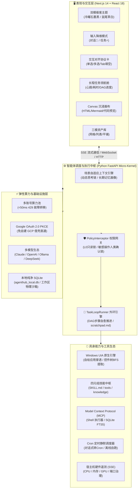

# AgentHub Local 产品白皮书与全量技术特性全景指南
> **Document Version**: `v1.1.2`  
> **Target Audience**: 视频制作 AI 分析、产品发布会物料、技术评审报告、商业推广与用户文档。  
> **Product Slogan**: 本地优先 · 谋定而动 · 具身自主 —— 属于极客的桌面级 AI 智能体工作台

---

## 一、 产品概述与核心定位 (Product Overview & Positioning)

### 1.1 什么是 AgentHub Local？
**AgentHub Local** 是一款面向个人开发者、算法工程师与技术极客的**桌面级自主具身 AI 智能体工作台（Autonomous Embodied AI Desktop Studio）**。它将大语言模型的认知推理能力，与本地操作系统的底层执行权限（文件读写、终端命令、GUI 控件交互、硬件遥测）进行深度融合，打造一个真正具备“思考规划、具身实操、长程自愈、资产交付”全链路闭环的本地化数字员工。

### 1.2 为什么需要 AgentHub Local？（解决现有 AI 工具的 4 大硬伤）
1. **硬伤一：配额频繁枯竭与服务中断（429 焦虑）**  
   * *现状*：开发者使用网页版或单一 API 时，频繁遭遇 `429 Too Many Requests`，任务直接报废。
   * *AgentHub 解法*：内置 Google 官方桌面端 OAuth PKCE 借壳直通，聚合多账号弹性算力池，实现 **<50ms 自动故障熔断转移**，7×24 小时算力永不枯竭。
2. **硬伤二：缺乏意图对齐，盲目动工导致反复返工**  
   * *现状*：传统 Agent 接到一句模糊需求就直接大面积乱写文件，方向跑偏后需要人类花费大量时间回滚修复。
   * *AgentHub 解法*：业内首创**「谋定而后动（Plan-First）」意图对齐引擎**，动工前启用物理级只读硬门控，结合交互式对齐协议卡与 Tab 键快速填空，确认方案后方才入轨执行。
3. **硬伤三：无桌面具身操作能力，止步于“代码生成器”**  
   * *现状*：现有工具只能在封闭沙箱里输出代码片段，无法操作本地无 API 的桌面端软件（如微信、钉钉、行业自绘客户端）。
   * *AgentHub 解法*：深度搭载 **Windows 原生 UI Automation (UIA) 控件树穿透引擎**，实现像素级坐标与无障碍树双模穿透，支持跨软件协同与具身自动化。
4. **硬伤四：环境配置极其繁琐，代码与私有数据存在云端泄漏风险**  
   * *现状*：传统开源项目需要用户本地安装复杂且容易冲突的 Python/Node.js/C++ 依赖，且许多工具会强行将本地源码回传第三方云服务器。
   * *AgentHub 解法*：**独立免安装绿色便携架构**（解压即用，体积约 32MB，自带精简 Python 3.12 运行时）；坚持 **100% 本地优先（Local-First）**，所有数据、数据库、历史记录均留在本地磁盘，零数据泄漏。

---

## 二、 核心全景架构与技术选型 (System Architecture)

### 2.1 系统架构拓扑图



### 2.2 核心技术栈规范
* **桌面宿主**: Microsoft WebView2 原生渲染 + PyInstaller 绿色免安装封装；
* **后端内核**: Python 3.12 嵌入式运行时 + FastAPI + Pydantic v2 + aiosqlite；
* **前端工程**: Next.js 14（SSG 静态导出，零 Node.js 生产依赖）+ TypeScript + Tailwind CSS；
* **本地存储**: 纯本地 SQLite + FTS5 全文索引引擎（支持毫秒级代码与文档检索）；
* **通信协议**: Server-Sent Events (SSE) 高并发流式传输 + 本机回环动态鉴权令牌（防 DNS 重绑定）。

---

## 三、 全量技术特性矩阵与功能详解 (Comprehensive Features)

---

### 特性 1：多账号弹性算力池与毫秒级高可用容灾 (Power Pool & Failover)

* **Google 官方桌面端 OAuth 2.0 (PKCE) 借壳直通**：
  * 巧妙复用官方桌面端公开 Client ID 与标准 S256 PKCE 加密验证流；
  * **零配置门槛**：开发者无需自行申请 Google Cloud Platform (GCP) 企业开发者资质，无需绑定海外信用卡；
  * **双通道验证捕获**：
    * *通道 A（自动回环）*：内置 `127.0.0.1:1455` 回调监听器，浏览器点击同意后毫秒级静默截获 Code 入库；
    * *通道 B（无头/指纹浏览器）*：支持手动粘贴完整回调 URL 或 Code，完美兼容 VPS、远程桌面与指纹浏览器。
* **毫秒级 429 故障转移熔断机制 (<50ms Failover)**：
  * 内置滑动窗口 RPM/TPM 配额监控算法；
  * 当主力账号因高频并发触发 Google 429 频率限制时，系统在 **小于 50ms 内完成熔断检测**，并自动透明平移至算力池中下一个可用账号；
  * 对前端用户完全无感知，无需手动重试，杜绝长文本生成或大工程编写中断。
* **令牌静默持久化与自动续期**：
  * 后台守护协程基于 `refresh_token` 在访问令牌过期前自动完成静默续期与内存缓存；
  * 配合安全混淆算法，凭据仅保留在本地。
* **全模型自由混部接入**：
  * 除内置的 Google 系列模型（Gemini 2.5 Pro、Flash 等）外，全面原生兼容 OpenAI 协议（Claude 3.5 Sonnet、GPT-4o、DeepSeek-V3/R1 等）；
  * 原生支持本地 Ollama、vLLM、LM Studio 私有大模型，支持按任务场景混用。

---

### 特性 2：「谋定而后动」意图对齐引擎 (Plan-First Alignment Engine)

> **核心哲学**：不打无准备之仗。动工前做深度的结构化意图对齐，宁可先花 10 秒确认参数，也不在方向跑偏后花费 10 分钟重构返工。

* **双模式输入降维架构**：
  * **`💬 对话模式 (只读澄清)`**：
    * 专用于概念探讨、代码解释与灵感构思；
    * 提供 **`[🧭 需求澄清 (Clarify)]`** 开关：开启后，遇到模糊提问先抛结构化选项对齐，再输出深度长文。
  * **`⚡ 任务模式 (具身执行)`**：
    * 专用于工程落地、脚本生成、文件批量修改与系统运维；
    * 提供 **`[⚡ 直接执行 | 📋 谋定而动]`** 策略胶囊。
* **物理级 L0 安全只读硬门控 (Hard Gate)**：
  * 区别于业内其他仅靠 System Prompt 叮嘱模型“不要先写文件”（大模型极易“手滑”偷写代码）；
  * AgentHub 在底层 `PolicyInterceptor` 进行**物理级算子隔离**：处于计划对齐阶段时，模型只能调用 `read_local_file`、`list_dir`、`web_fetch` 等安全只读工具；
  * 模型既能静默勘探工作区现存源码与目录结构（确保给出的方案精确到真实文件名与行号），又物理上完全无法篡改或删除任何文件。
* **`interactive_inquiry` 结构化对齐协议卡**：
  * **流式防抖骨架屏 (Streaming Skeleton)**：针对 SSE 流式吐字阶段 JSON 未闭合的特性，自动展示脉冲加载动画，闭合后毫秒级无损转换为可交互表单，杜绝页面闪烁与报错；
  * **复合表单能力**：单张卡片内可自由组合单选（推荐策略）、多选（交付产物勾选）与填空项；
  * **极客 `Tab` 键跳跃填空**：
    * 模板采用标准语法 `{{参数名:默认值或提示}}`（如 `数据库连接串为 {{DB_URL:postgresql://localhost:5432/mydb}}`）；
    * 用户点击【填入输入框】，系统自动选中第一个 `{{...}}` 占位符；
    * 用户敲键盘覆盖输入后，**按下 `Tab` 键** 直接丝滑跳转到下一个占位符继续填空！
* **Approve & Act 方案审批与 Loop 引擎无缝交接**：
  * 方案列表包含细分步骤清单（支持用户勾选微调）；
  * 用户点击 **【🚀 确认方案并开始执行】**，系统立刻将确认后的任务清单写入物理工作区的 **`.agenthub/scratchpad.md`**，物理解锁写权限，直推外环 Loop 引擎自驱推进。

---

### 特性 3：长程任务自驱循环与全景领航舱 (Task Loop Runner & Loop HUD)

* **基于 DAG 任务树的外环自愈循环**：
  * 严格遵循业界权威的智能体闭环推演体系：目标拆解 → 确定性算子调用 → 执行回显捕获 → 自诊断与自动修正；
  * 单一任务支持长程多步推演，遇到执行报错自动分析终端 stderr，自动调整参数后自愈重试。
* **长程领航舱 (Loop HUD)**：
  * 顶部常驻极客仪表板，实时展示：
    * **运行状态**：正在推演 / 等待审批 / 已完成 / 已暂停；
    * **时间与心跳**：长程任务累计总耗时、当前轮次心跳监测；
    * **DAG 进度**：当前正在执行第几步、总步数与步骤名称；
    * **控制中枢**：支持随时物理挂起（Pause）、继续（Resume）或提前终止。
* **敏感高危操作人类确认锁 (Human-in-the-Loop)**：
  * 当智能体推演过程中涉及到以下动作时，自动触发中断挂起：
    * 删除文件或清空目录；
    * 覆盖关键系统级配置文件；
    * 终止外部进程或执行不可逆系统命令；
  * 必须经过用户在界面点击高保真【批准】弹窗后方可继续，保障生产系统绝对安全。

---

### 特性 4：Windows 原生 UI 自动化穿透引擎 (Embodied Desktop & UIA)

* **穿透封闭无 API 应用 (Windows UI Automation 原生引擎)**：
  * 针对大量缺乏开放 Web API 的桌面应用（如微信 4.0+、钉钉、各种专有行业系统客户端、自绘 Qt / CEF / Electron 窗体）；
  * 原生基于 Windows `user32.dll` 与 `.NET UI Automation` 无障碍树穿透；
  * 具备 BFS RawViewWalker 遍历机制，自动克服懒加载自绘断层，提取物理坐标 `[x, y, w, h]` 与控件类型。
* **桌面沙箱穿透与防乱码交互**：
  * 具备桌面沙箱穿透能力（自动锁定到活动用户交互桌面 `WinSta0\default`）；
  * 采用 Windows 剪贴板原生注入与中文防乱码粘贴（`^v`），彻底避免普通模拟按键出现的中文漏字乱码。
* **系统硬件遥测与环境治理**：
  * **低功耗 SSE 硬件快照**：前端按需流式拉取 CPU 占用率、物理内存余量、GPU 负载及 Top 资源消耗进程；
  * **端口占用一键排查**：输入端口号（如 8080），自动探测占用进程 PID 与程序名，生成安全释放提案；
  * **受保护进程白名单**：强制拦截对操作系统关键核心进程（`explorer.exe`, `dwm.exe`, `system` 等及 AgentHub 自身）的操作，严防误操作引发系统崩溃。

---

### 特性 5：沙箱物理工作区与资产交付中枢 (Workspaces & Library)

* **工作区物理级严格隔离**：
  * 支持按不同项目或客户创建物理工作区；
  * 每个工作区拥有独立的本地磁盘目录、专属环境变量、独立的 `.agenthub` 状态机与长期记忆画像，杜绝跨项目上下文串扰。
* **Windows 资源管理器级资产库 (Library View)**：
  * **自动索引登记**：对话落盘的代码、长程任务生成的报表、爬取的 CSV 数据，均自动索引登记在当前工作区资产库中；
  * **三模随心切换**：
    * *网格大图标模式 (Grid)*：直观展示文件夹与文件资产量，具备大图标预览感；
    * *Windows 详细列表模式 (Table)*：详细呈现文件名、类型标签、物理字节大小、最后修改时间；
    * *全部平铺总览模式 (Flat)*：一键平铺当前工作区深层目录中的所有产物；
  * **本地系统无缝联动**：点击按钮即可在系统文件资源管理器（Explorer）中一键打开目录或高亮定位目标文件。
* **Canvas 沉浸式侧边抽屉画布**：
  * 支持在主界面随时滑出独立的 Canvas 画布抽屉；
  * **多模态实时渲染**：
    * 响应式 HTML / Web 前端组件实时交互与沙箱运行；
    * Mermaid 复杂流程图、时序图、架构图无损矢量渲染；
    * 现代化语法高亮代码编辑器；
  * 实现左侧智能体推演、右侧实时预览效果的高效分屏工作流。

---

### 特性 6：标准化四元组技能生态与 MCP 原生热插拔 (Skills & MCP)

* **标准四元组技能包规范 (Skill-as-a-Folder)**：
  * 规范化每个技能的目录架构：
    ```text
    skills/<skill-name>/
    ├── SKILL.md          # [必选] YAML 元数据 (name, command, description) + 详细 SOP 规程
    ├── tools/            # [可选] 确定性 Python 算子脚本 (接收命令行 JSON 并输出确定结果)
    ├── knowledge/        # [可选] 领域专业参考文档 (*.md / *.txt / *.csv)
    └── schema.json       # [可选] 结构化输入输出 JSON Schema 校验契约
    ```
* **L1 底座与 L2 工作区分层加载机制**：
  * L1 全局底座技能跨项目常驻；
  * L2 物理工作区专属技能，支持对 L1 技能同名高优覆盖，实现“项目级个性化定制”。
* **内置母技能：`skill-creator`**：
  * 用户完成一段复杂、精妙的对话推演后，只需输入 `/new-skill` 或交代“把刚才跑通的操作做成一个技能”；
  * 系统在 3 分钟内自动提取步骤 SOP、生成工具脚本目录骨架并完成热加载，实现“以技能制造技能”。
* **Model Context Protocol (MCP) 原生热插拔**：
  * 完美兼容 Anthropic 开放协议规范；
  * 开箱即用内置 Local Shell 终端执行器与 SQLite FTS5 本地零拷贝全文索引。

---

### 特性 7：后台静默自动化定时调度引擎 (Scheduled Tasks)

* **自然语言对话式任务规划**：
  * 无需手写晦涩的 Cron 表达式；
  * 直接通过对话向导输入大白话（例如：“每个工作日早上 9 点拉取团队日报，比对异常后生成汇总 Excel”）；
  * AI 自动解析并推导出标准 5 段式 Cron 表达式与执行 Prompt 模板。
* **后台静默常驻调度**：
  * 智能体在后台静默运行守护，到达预定时间窗口自动唤醒；
  * 全自动执行推理逻辑并将最终成果写入资产库，支持单次立即试跑、暂停与执行历史复盘。

---

### 特性 8：极客双模设计与绿色免安装微内核 (Design & Micro-Kernel)

* **Strata 极客双模设计系统 (Dual-Theme System)**：
  * **冷曜石墨黑 (Obsidian Emerald)**：深沉内敛的石墨底色搭配荧光翡翠绿微光，专为深夜极客打造，沉浸专注；
  * **温润鼠尾草白 (Sage Minimal)**：专为白天办公调优的高透气鼠尾草白（`#f4f6f5`），消除纯白刺眼眩光，彻底根除死黑残留；
  * 遵循严格的语义化 Token 规范，支持跟随操作系统或一键秒切。
* **独立免安装绿色便携运行包 (Release v1.1.2)**：
  * **解压即用**：打包体积约 32MB，解压后双击 `AgentHub.exe` 瞬间启动；
  * **零依赖要求**：彻底告别“配 Python 虚拟环境配到崩溃”、“Node.js npm install 依赖报错”的噩梦；
  * **100% 数据本地自主掌控**：
    * 数据库采用本地 SQLite；
    * 源码与会话记录仅存放在当前工作区，不产生任何中心化遥测，不外泄代码。

---

## 四、 核心竞争优势对比 (Competitive Matrix)

| 核心对比维度 | AgentHub Local (v1.1.2) | 传统 Web 聊天 (ChatGPT / Claude) | IDE 插件 (Cursor / Copilot) | 命令行 Agent (Aider / Claude Code) |
| :--- | :---: | :---: | :---: | :---: |
| **算力连续性** | **多账号池 + <50ms 429 秒切** | 容易触发 429，一旦限流完全中断 | 依赖官方 Token / 订阅额度 | 依赖单 Key 额度，用完即停 |
| **执行前意图对齐** | **「谋定而动」L0硬锁 + Tab填空** | 无（只能被动回答文字） | 弱（依靠侧边栏简单追问） | 较弱（直接敲命令或改文件） |
| **桌面具身操作** | **支持 Windows UIA 原生控件穿透** | 完全无本地桌面交互能力 | 仅限当前 IDE 打开的工程 | 仅限命令行 Shell 脚本 |
| **长程状态领航** | **Loop HUD 全景长程领航舱** | 无长程推演与状态感知 | 仅行级 Diff | 终端纯滚动纯文本日志 |
| **资产与成果交付** | **资源管理器级资产库 + Canvas 画布** | 只能手动从气泡复制文本 | 依赖 IDE 自身文件树 | 文件散落在终端目录中 |
| **定时后台调度** | **原生对话转 Cron 定时后台守护** | 无 | 无 | 需配合系统 crontab 外部配置 |
| **环境门槛** | **免配环境绿色便携（解压即跑）** | 无需配置（但功能受限在云端） | 需安装大型 VSCode 宿主 | 需熟练配置 Python/Node/Git |
| **数据隐私性** | **100% 本地优先，数据绝不出机** | 源码需上传第三方云端服务器 | 代码需索引上传云端服务器 | 取决于本地配置与 API 协议 |

---

## 五、 四大典型商业与极客落地场景 (Use Cases)

### 场景 1：复杂业务脚本与长程工程开发（谋定而动）
* **应用案例**：批量处理 500 个不同格式的 Excel/CSV 表格并核验对账。
* **工作流**：在【任务模式 · 谋定而动】下输入需求 → 引擎物理锁定只读权限，探测表格表头差异 → 弹出 `interactive_inquiry` 对齐卡核验主键策略 → 用户通过 `Tab` 键秒级填入豁免参数 → 点击批准方案 → 自动持久化到 `scratchpad.md`，Loop 引擎全自动推演并输出高亮差异报表至资产库。

### 场景 2：跨软件协同与无 API 桌面具身自动化
* **应用案例**：财务与客服跨系统报销核验。
* **工作流**：Agent 利用 UIA 引擎自动抓取当前屏幕上未提供 API 的专有财务客户端窗体，提取表格数据，通过本地 Shell 比对本地 SQLite 数据库，再将结果模拟粘贴发送至钉钉/企业微信群组中。

### 场景 3：7×24 小时后台静默巡检与数据抓取
* **应用案例**：工作日定时拉取海外竞品更新与代码库依赖漏洞扫描。
* **工作流**：通过对话创建定时任务（如“工作日凌晨 2 点执行依赖扫描与 CVE 对比”）→ 系统后台静默守候，定时唤醒 Agent 抓取分析，生成 Markdown 审计公报自动归档入库。

### 场景 4：个人与团队工作流资产化（以技能沉淀技能）
* **应用案例**：将一次成功的 Git 分支回滚或复杂日志排障操作固化为可复用工具。
* **工作流**：排障完毕后输入 `/new-skill`，母技能自动提取上下文步骤，生成标准四元组（SOP、算子脚本、知识文档），直接热加载，团队任何成员输入 `/<command>` 即可一键复用。

---

## 六、 总结与结语 (Conclusion)

**AgentHub Local v1.1.2** 彻底打破了“大模型只能在云端网页里做文字问答”的局限，走出了一条**“本地优先 (Local-First)”、“谋定而动 (Plan-First)”、“具身自主 (Embodied Autonomy)”**的全新技术范式。

它既为极客提供了算力永不枯竭、零数据外泄的纯粹本地桌面工具，又为自动化智能体从“聊天玩具”走向“工业级生产力交付”提供了最扎实的架构基石。
