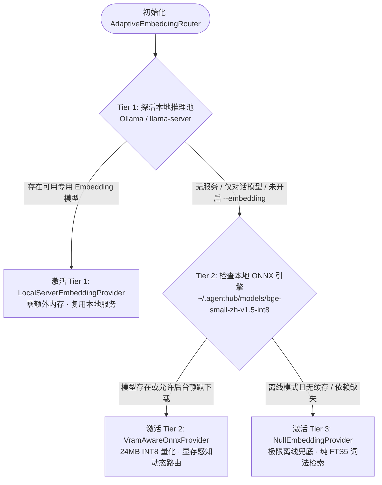

# AgentHub Local v1.5.5 专项设计方案：三级自适应 Embedding 与显存感知 ONNX 硬件加速路由

> **所属版本**：AgentHub Local `v1.5.5`（阶段一核心底座）  
> **目标模块**：`backend/app/search/embedding_provider.py`  
> **关联组件**：`CrossPlatformHardwareProbe`（硬件显存探针）、`EnginePoolService`（算力池）、`HybridSearchEngine`（混合检索引擎）  
> **设计红线**：零 PyTorch/TensorFlow 重型依赖、基础分发包增量 `< 35 MB`、单次实时检索 `< 10 ms`、本地大模型显存（VRAM）零抢占防爆机制。

---

## 1. 业务痛点与设计目标

在桌面端本地运行 **AgentHub Local** 时，Embedding（文本向量化）引擎面临着截然不同的双重算力诉求与资源冲突：

1. **实时交互检索 vs 离线海量建索引的算力矛盾**：
   * **单条 Query 实时编码（在线延迟敏感）**：用户提问或 Agent 执行 `workspace_hybrid_search` 时，单次输入仅为 $1 \sim 3$ 条短文本，要求延迟控制在 **$10\text{ ms}$ 以内**，同时不能为了算一条几十字的 Query 去初始化沉重的 GPU CUDA 上下文（单次初始化即可消耗 $300 \sim 600\text{ MB}$ 显存与数百毫秒延迟）。
   * **大批量文档建索引（吞吐敏感）**：首次挂载大型本地代码库或同步上千份企业微信微盘/WebDAV 文档时，需一次性编码数千至数万条文本切片。此时若能安全借用空闲 GPU 硬件加速，吞吐量可提升 $3 \sim 5$ 倍。
2. **与本地推理大模型（Ollama / `llama.cpp`）的显存零抢占保护**：
   * 在配备主流消费级显卡（如 NVIDIA RTX 4060 8GB / 4070 12GB）的开发机上，本地运行的 Qwen 7B/14B 量化模型通常已占用 $5.5 \sim 7.5\text{ GB}$ 显存。若 ONNX Runtime 盲目自动挂载 `CUDAExecutionProvider`，极易瞬间耗尽剩余显存，导致前台对话模型触发 **CUDA OOM（显存溢出崩溃）** 或被迫层卸载（Layer Offload）至内存造成生成速度暴跌。
3. **跨平台异构硬件与极限离线兼容性**：
   * 需同时兼容 Windows（NVIDIA CUDA / AMD & Intel DirectML / 多核 AVX2 CPU）、macOS（Apple Silicon CoreML / ARM NEON CPU）与 Linux 无显卡服务器，且在无外网、无本地模型缓存时能无缝退化为纯 FTS5 词法检索。

---

## 2. 三级自适应算力路由架构（Adaptive Tiered Routing）

系统启动或切换工作区时，`AdaptiveEmbeddingRouter` 按优先级顺序执行三级健康探测，确立当前活跃的向量后端：



### 2.1 Tier 1：本地推理服务复用 (`LocalServerEmbeddingProvider`)
* **探测逻辑**：查询 `EnginePoolService` 中已注册且健康状态为 `healthy` 的本地节点：
  * **Ollama 节点**：请求 `GET /api/tags`，匹配模型名称包含 `embed`、`bge`、`nomic`、`m3e`、`gte` 等特征的模型（优先选择 `bge-m3` 或 `nomic-embed-text`）；若存在，发起一次 4 字符探针调用 `POST /api/embeddings` 验证可用性。
  * **`llama-server` (`llama.cpp`) 节点**：探测 `POST /v1/embeddings`（需服务端启动时显式携带 `--embedding` 参数）；若返回 HTTP `200` 且返回有效浮点数组，则直接挂载复用。
* **核心优势**：复用已有进程，额外内存与显存占用严格为 **`0 MB`**。

### 2.2 Tier 2：显存感知轻量 ONNX 引擎 (`VramAwareOnnxProvider`)
* **默认内置模型选型**：**`BAAI/bge-small-zh-v1.5`（ONNX INT8 动态量化版）**
  * **模型参数量**：仅 `24M`，模型文件体积 **`~24.5 MB`**（含 `tokenizer.json` 总计 `< 26 MB`）；
  * **输出维度**：`512` 维（比 1024 维模型节省 50% SQLite `BLOB` 存储空间与 NumPy 矩阵点积耗时）；
  * **中英双语检索精度**：在 C-MTEB 中文检索与代码跨语言匹配基准上表现优异，非常适合中英文混合代码库与企业中文文档。
* **模型按需静默分发机制（不膨胀基础安装包）**：
  * 基础 PyInstaller 可执行包仅打包轻量 `onnxruntime` + `tokenizers` 运行时，**不内嵌模型权重文件**；
  * 首次触发 Tier 2 初始化时，后台非阻塞下载协程从国内镜像源（ModelScope / HF-Mirror 双源自动切换）下载模型至 `~/.agenthub/models/bge-small-zh-v1.5-int8/`，并强制执行 **SHA-256 哈希校验**；
  * 下载完成前，检索请求自动平滑走 Tier 3 纯词法模式，下载完成后热切换升级为混合检索，全程零阻塞、零报错。

### 2.3 Tier 3：极限离线纯词法降级 (`NullEmbeddingProvider`)
* 当用户处于完全断网内网环境、未部署 Ollama 且本地尚无 ONNX 缓存时，`NullEmbeddingProvider` 返回 `is_available = False`。
* `HybridSearchEngine` 自动将 RRF 权重调整为 $w_{\text{fts}} = 1.0, w_{\text{vec}} = 0.0$，退化为增强型 `SQLite FTS5 trigram` + 权威/时间重排检索，保证 100% 业务可用性。

---

## 3. 显存感知硬件加速与双会话生命周期管理（核心细节）

为了彻底解决“批量建索引要快”与“绝对不能抢占本地大模型显存”之间的矛盾，`VramAwareOnnxProvider` 摒弃了传统的单一全局 Session 设计，采用 **“常驻轻量 CPU 查询会话 + 显存门控按需 GPU 批处理会话（Dual-Session Lifecycle）”**。

### 3.1 四档用户配置策略 (`embedding_device_policy`)

在设置面板与环境变量（`AGENTHUB_EMBEDDING_DEVICE`）中提供以下策略选项（默认 **`auto`**）：

| 策略模式 | 单条/小批量查询 (`batch <= 32`) | 大批量建索引 (`batch > 32`) | 适用人群与硬件场景 |
| :--- | :--- | :--- | :--- |
| **`auto`（默认推荐）** | 强制锁定 **`CPUExecutionProvider`** | 调用显存探针动态决策：**空闲显存 $\ge 2.5\text{ GB}$ 时挂载 GPU 加速**，否则走多核 CPU | 兼顾 RTX 4060/4070 等本地跑大模型的开发机，既保显存安全又享空闲加速 |
| **`cpu`（绝对显存隔离）** | 强制锁定 **`CPUExecutionProvider`** | 强制锁定 **`CPUExecutionProvider`** | 显存极度紧张（如 6GB/8GB 显卡满载跑 14B 模型）或纯 CPU 办公本 |
| **`gpu`（全速硬件加速）** | 挂载 GPU 执行提供器 | 挂载 GPU 执行提供器 | 拥有 16GB/24GB+ 大显存工作站，或完全使用云端 API 不跑本地推理模型 |
| **`directml`（Windows 通用加速）** | 走 CPU 低延迟会话 | 挂载 **`DmlExecutionProvider`**（核显/独显通用） | Windows 平台无 NVIDIA 独显、希望利用 Intel Iris / AMD 核显加速批处理 |

### 3.2 `auto` 模式下的显存门控与按需批处理状态机

当 `HybridSearchEngine` 后台索引队列积压超过阈值（默认 `pending_chunks >= 64`）触发批量向量化任务时，执行如下精准调度：

1. **实时显存水位探针 (`CrossPlatformHardwareProbe.get_vram_status()`)**：
   * **NVIDIA GPU**：通过 `pynvml` 或轻量 `nvidia-smi --query-gpu=memory.free,memory.total --format=csv,noheader,nounits` 查询实时空闲显存 `free_vram_mb`（查询结果缓存 `3` 秒，避免频繁系统调用）；
   * **Apple Silicon (macOS)**：统一内存架构下直接启用 `CoreMLExecutionProvider`（或 Accelerate 优化 CPU），内存水位安全线设为系统可用内存 $\ge 4.0\text{ GB}$。
2. **安全阈值硬门控（`SAFE_VRAM_THRESHOLD_MB = 2560`）**：
   * 仅当 `free_vram_mb >= 2560`（至少保留 $2.5\text{ GB}$ 显存冗余，远大于 ONNX 批处理峰值所需的 $\sim 450\text{ MB}$）且前台当前无高负载生成锁（`runtime.is_generating == False`）时，才允许创建临时 GPU 批处理会话。
3. **用完即焚与显存彻底回收（Ephemeral GPU Session）**：
   * 批处理队列消费完毕（或连续 `15` 秒无新批次任务到达）后，立即显式销毁临时 GPU `InferenceSession` 并执行 `gc.collect()`，确保显存占用瞬间归零，绝不长期霸占显卡资源。
   * **运行时异常自愈**：若在 GPU 批处理过程中遭遇任何驱动异常或 `ORT_EP_FAIL` / OOM 错误，自动捕获异常、释放 GPU 会话，并在同一次调用内无缝切换至常驻 CPU 会话完成剩余切片计算，对外零报错。

---

## 4. 硬件执行提供器（Execution Provider）平台适配矩阵

在加载 ONNX Runtime Session 时，按操作系统与硬件环境构建精准的 `providers` 优先级列表与线程约束：

| 运行平台 | GPU 加速可用时的 Provider 链 | 常驻 CPU 会话线程与图优化配置 |
| :--- | :--- | :--- |
| **Windows (x64)** | `['CUDAExecutionProvider', 'DmlExecutionProvider', 'CPUExecutionProvider']`<br>*(注：配置 `arena_extend_strategy='kSameAsRequested'` 禁止 CUDA 预分配全部显存)* | `graph_optimization_level = ORT_ENABLE_ALL`<br>`intra_op_num_threads = min(4, cpu_count // 2)`<br>`inter_op_num_threads = 1` |
| **macOS (Apple Silicon)** | `['CoreMLExecutionProvider', 'CPUExecutionProvider']` | `graph_optimization_level = ORT_ENABLE_ALL`<br>`intra_op_num_threads = 4` |
| **Linux (x64 / ARM64)** | `['CUDAExecutionProvider', 'CPUExecutionProvider']` | `graph_optimization_level = ORT_ENABLE_ALL`<br>`intra_op_num_threads = min(4, cpu_count // 2)` |

> **关键防爆显存参数说明**：在创建 `CUDAExecutionProvider` 时，**必须显式传入** `provider_options=[{"arena_extend_strategy": "kSameAsRequested", "gpu_mem_limit": 768 * 1024 * 1024}]`，将 ONNX Runtime 的显存申请上限硬锁定在 **`768 MB`** 以内，从底层 C++ 分配器根除显存无限扩张风险。

---

## 5. 核心代码结构与类接口契约 (`backend/app/search/embedding_provider.py`)

```python
from __future__ import annotations

import asyncio
import gc
import hashlib
import logging
import os
import time
from abc import ABC, abstractmethod
from dataclasses import dataclass
from pathlib import Path
from typing import Literal, Optional

import numpy as np

logger = logging.getLogger(__name__)

DevicePolicy = Literal["auto", "cpu", "gpu", "directml"]


@dataclass(frozen=True)
class EmbeddingRuntimeStatus:
    """暴露给前端状态栏与诊断 API 的 Embedding 运行态快照"""
    tier: Literal["tier1_local_server", "tier2_onnx", "tier3_lexical_fallback"]
    model_id: str
    dimension: int
    active_device: str                  # e.g. "ollama:bge-m3" | "onnx:cpu" | "onnx:cuda(ephemeral)" | "none"
    device_policy: DevicePolicy
    is_available: bool
    model_downloading: bool = False
    download_progress: float = 0.0
    last_batch_latency_ms: float = 0.0


class BaseEmbeddingProvider(ABC):
    """统一向量编码器抽象基类"""

    @property
    @abstractmethod
    def model_id(self) -> str: ...

    @property
    @abstractmethod
    def dimension(self) -> int: ...

    @property
    @abstractmethod
    def is_available(self) -> bool: ...

    @abstractmethod
    async def encode_query(self, text: str) -> Optional[np.ndarray]:
        """单条实时查询编码（要求 < 10ms，L2 归一化 float32 一维向量）"""

    @abstractmethod
    async def encode_batch(self, texts: list[str], batch_size: int = 32) -> Optional[np.ndarray]:
        """批量建索引编码（支持显存门控加速，返回 L2 归一化 float32 二维矩阵 [N, D]）"""

    @abstractmethod
    def get_status(self) -> EmbeddingRuntimeStatus: ...


class VramAwareOnnxProvider(BaseEmbeddingProvider):
    """
    Tier 2: 显存感知型轻量 ONNX Runtime 向量编码器
    - 常驻轻量 CPU Session 负责毫秒级实时查询
    - 大批量建索引时探测空闲显存，安全时按需拉起受限 GPU Session（硬上限 768MB），用完即焚
    """
    SAFE_VRAM_THRESHOLD_MB = 2560
    GPU_BATCH_TRIGGER_MIN_ITEMS = 64
    GPU_SESSION_IDLE_TTL_SEC = 15.0

    def __init__(
        self,
        model_dir: Path,
        device_policy: DevicePolicy = "auto",
        hardware_probe=None,
    ) -> None:
        self._model_dir = model_dir
        self._device_policy: DevicePolicy = device_policy
        self._hardware_probe = hardware_probe
        self._cpu_session = None
        self._gpu_session = None
        self._gpu_last_used_at: float = 0.0
        self._tokenizer = None
        self._lock = asyncio.Lock()
        self._last_latency_ms: float = 0.0

    @property
    def model_id(self) -> str:
        return "bge-small-zh-v1.5-int8"

    @property
    def dimension(self) -> int:
        return 512

    @property
    def is_available(self) -> bool:
        return (self._model_dir / "model_quantized.onnx").exists() and (
            self._model_dir / "tokenizer.json"
        ).exists()

    def _can_use_gpu_for_batch(self, item_count: int) -> bool:
        """评估当前批次是否允许启用 GPU 硬件加速"""
        if self._device_policy == "cpu":
            return False
        if self._device_policy in ("gpu", "directml"):
            return True
        # auto 模式：小批次直接走 CPU 避免上下文开销；大批次检查空闲显存红线
        if item_count < self.GPU_BATCH_TRIGGER_MIN_ITEMS:
            return False
        if self._hardware_probe is None:
            return False
        vram_info = self._hardware_probe.get_vram_status()
        if not vram_info or not vram_info.get("has_gpu"):
            return False
        free_mb = vram_info.get("free_vram_mb", 0)
        return free_mb >= self.SAFE_VRAM_THRESHOLD_MB

    def release_ephemeral_gpu_session(self) -> None:
        """释放临时 GPU 批处理会话，确保不长期占用本地大模型显存"""
        if self._gpu_session is not None:
            self._gpu_session = None
            gc.collect()
            logger.info("Released ephemeral ONNX GPU batch session to reclaim VRAM.")
```

---

## 6. 性能基准与安全验收指标（KPI）

在 `backend/tests/test_embedding_vram_routing.py` 中强制校验以下工程指标：

1. **单条实时检索延迟**：在 CPU 模式下对单条中文查询编码，95 分位延迟（P95）**$< 12\text{ ms}$**，内存增量 **$< 100\text{ MB}$**。
2. **批量建索引吞吐**：2,000 条 512 字符切片全量向量化，CPU 模式下耗时 **$< 6\text{ s}$**；在空闲显存充足自动触发 CUDA 加速时耗时 **$< 1.5\text{ s}$**。
3. **显存防爆硬保护验证**：
   * Mock 硬件探针返回 `free_vram_mb = 1200`（模拟本地已加载 Qwen 14B 量化模型）并输入 500 条批量文本时，断言路由严格锁定 `CPUExecutionProvider`，零 GPU 会话创建；
   * Mock `free_vram_mb = 5200` 且输入 500 条批量文本时，断言启用带 `gpu_mem_limit = 768MB` 的 `CUDAExecutionProvider`，并在任务结束或空闲 15 秒后成功触发 `release_ephemeral_gpu_session()`。
4. **故障无缝回退**：模拟 GPU Provider 初始化抛出 `RuntimeError` 时，断言自动捕获并由 CPU 会话无缝兜底返回正确的 `[N, 512]` 归一化向量矩阵，不向上层抛出任何异常。